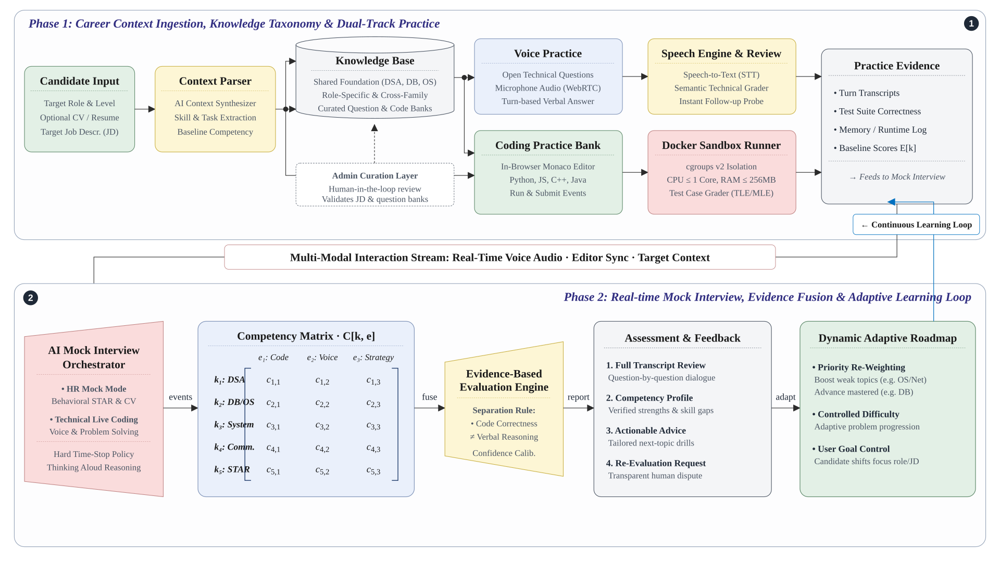

# TÀI LIỆU ĐỀ CƯƠNG ĐỒ ÁN (PROJECT PROPOSAL)

## MÔN HỌC: NHẬP MÔN CÔNG NGHỆ PHẦN MỀM

**ĐỀ TÀI:**

# NỀN TẢNG LUYỆN TẬP VÀ MÔ PHỎNG PHỎNG VẤN IT CÁ NHÂN HÓA (DEVORDEAD)

*Role-driven Practice · Voice-first Mock Interview · Adaptive Preparation*

---

### THÔNG TIN NHÓM SINH VIÊN THỰC HIỆN:

| STT | Họ và Tên                   | Mã số sinh viên |       Email sinh viên       |
| :-: | :----------------------------- | :----------------: | :---------------------------: |
|  1  | **Nguyễn Phúc Khang**  | **24120068** | 24120068@student.hcmus.edu.vn |
|  2  | **Phạm Minh Trọng**    | **24120151** | 24120151@student.hcmus.edu.vn |
|  3  | **Hoàng Trọng Nghĩa** | **24120103** | 24120103@student.hcmus.edu.vn |
|  4  | **Nguyễn Hoàng Nhật** | **24120110** | 24120110@student.hcmus.edu.vn |

**Năm học:** 2026 – 2027
**Thành phố Hồ Chí Minh, Tháng 10/2026**

---

# MỤC LỤC

- [TÀI LIỆU ĐỀ CƯƠNG ĐỒ ÁN (PROJECT PROPOSAL)](#tài-liệu-đề-cương-đồ-án-project-proposal)
  - [MÔN HỌC: NHẬP MÔN CÔNG NGHỆ PHẦN MỀM](#môn-học-nhập-môn-công-nghệ-phần-mềm)
- [NỀN TẢNG LUYỆN TẬP VÀ MÔ PHỎNG PHỎNG VẤN IT CÁ NHÂN HÓA (DEVORDEAD)](#nền-tảng-luyện-tập-và-mô-phỏng-phỏng-vấn-it-cá-nhân-hóa-devordead)
  - [THÔNG TIN NHÓM SINH VIÊN THỰC HIỆN:](#thông-tin-nhóm-sinh-viên-thực-hiện)
- [MỤC LỤC](#mục-lục)
- [2. PHÁT BIỂU BÀI TOÁN SƠ LƯỢC](#2-phát-biểu-bài-toán-sơ-lược)
  - [2.1 Nghiệp vụ bài toán](#21-nghiệp-vụ-bài-toán)
    - [Mục tiêu và giải pháp của đề tài:](#mục-tiêu-và-giải-pháp-của-đề-tài)
  - [2.2 Môi trường hoạt động](#22-môi-trường-hoạt-động)
  - [2.3 Các ràng buộc về thiết kế \& triển khai](#23-các-ràng-buộc-về-thiết-kế--triển-khai)
- [3. GIẢI PHÁP ĐỀ XUẤT](#3-giải-pháp-đề-xuất)
  - [3.1 Phần mềm](#31-phần-mềm)
    - [3.1.1 Danh sách các chức năng phần mềm](#311-danh-sách-các-chức-năng-phần-mềm)
      - [Các quy định nghiệp vụ liên quan (Business Rules):](#các-quy-định-nghiệp-vụ-liên-quan-business-rules)
    - [3.1.2 Kiến trúc tổng thể phần mềm](#312-kiến-trúc-tổng-thể-phần-mềm)
      - [Thuyết minh các thành phần kiến trúc:](#thuyết-minh-các-thành-phần-kiến-trúc)
  - [3.2 Phần cứng](#32-phần-cứng)
    - [3.2.1 Yêu cầu phần cứng phía Người dùng (Client)](#321-yêu-cầu-phần-cứng-phía-người-dùng-client)
    - [3.2.2 Yêu cầu phần cứng phía Máy chủ (Server \& Cloud Infrastructure)](#322-yêu-cầu-phần-cứng-phía-máy-chủ-server--cloud-infrastructure)
  - [3.3 Thiết kế Giao diện Người dùng (UI/UX Mockups &amp; Interactive Prototype)](#33-thiết-kế-giao-diện-người-dùng-uiux-mockups--interactive-prototype)
- [4. KẾ HOẠCH PHÁT TRIỂN](#4-kế-hoạch-phát-triển)
- [5. KẾ HOẠCH NHÂN SỰ \& CHI PHÍ](#5-kế-hoạch-nhân-sự--chi-phí)
  - [5.1 Kế hoạch nhân sự](#51-kế-hoạch-nhân-sự)
  - [5.2 Kế hoạch chi phí dự kiến](#52-kế-hoạch-chi-phí-dự-kiến)
    - [KẾT LUẬN \& CAM KẾT CỦA NHÓM](#kết-luận--cam-kết-của-nhóm)

---

# 2. PHÁT BIỂU BÀI TOÁN SƠ LƯỢC

## 2.1 Nghiệp vụ bài toán

Trong bối cảnh ngành Công nghệ Thông tin (CNTT) ngày càng phát triển và yêu cầu tuyển dụng ngày một khắt khe, sinh viên các ngành Khoa học Máy tính, Kỹ thuật Phần mềm và các lập trình viên mới bắt đầu sự nghiệp (giai đoạn thực tập sinh, fresher, junior dưới 2 năm kinh nghiệm) gặp phải rào cản rất lớn khi tham gia các kỳ phỏng vấn tuyển dụng thực tế.

Qua khảo sát và phân tích thực tiễn, nhóm nhận thấy các khó khăn mang tính hệ thống như sau:

1. **Thiếu chuẩn tham chiếu theo vị trí (Role-based Fragmentation):** Ứng viên thường hoang mang không biết vị trí ứng tuyển mục tiêu (ví dụ: Backend Engineer, Frontend Engineer, AI/Data Engineer...) ở cấp độ Intern hay Junior cần thành thạo những khối kiến thức nền tảng (Foundations) nào và với độ sâu tới đâu.
2. **Sự phân mảnh công cụ chuẩn bị:** Hiện tại, người học phải tự chắp vá việc ôn luyện từ nhiều nguồn riêng biệt: luyện giải thuật trên LeetCode/HackerRank, đọc lý thuyết trên các bài viết blog/tài liệu kỹ thuật, tự nhẩm câu trả lời một mình hoặc tìm kiếm các bộ câu hỏi phỏng vấn chung chung trên mạng. Thiếu một nền tảng tích hợp xuyên suốt giúp gắn kết kiến thức nền tảng, kỹ năng giải quyết bài toán và kỹ năng giao tiếp phản xạ.
3. **Khoảng cách lớn giữa viết code và giao tiếp kỹ thuật bằng lời nói:** Vòng phỏng vấn kỹ thuật (Technical Interview) không đơn thuần là nộp mã nguồn cho máy chấm, mà đòi hỏi ứng viên phải giao tiếp, diễn giải tư duy thuật toán (think aloud), giải thích cơ chế hoạt động bên dưới (như Indexing trong Database, Garbage Collection trong JVM, Event Loop trong JavaScript, cơ chế Attention trong Transformer...) và so sánh ưu/nhược điểm giữa các giải pháp kiến trúc. Việc chỉ đọc tài liệu thụ động hoặc làm bài trắc nghiệm không tạo ra phản xạ trả lời bằng giọng nói dưới áp lực thời gian thực.
4. **Hạn chế của các công cụ AI hiện tại:** Mặc dù các mô hình Generative AI đa năng (ChatGPT, Claude...) có thể sinh câu hỏi nhanh chóng, nhưng thường gặp tình trạng đặt câu hỏi lý thuyết định nghĩa vụn vặt, trùng lặp, thiếu chiến lược phỏng vấn theo ngữ cảnh bản mô tả công việc (JD) hoặc hồ sơ năng lực (CV), và thiếu cơ chế ghi nhận bằng chứng đánh giá khách quan.

### Mục tiêu và giải pháp của đề tài:

Đồ án **DevOrDead — Nền tảng luyện tập và mô phỏng phỏng vấn IT cá nhân hóa** được xây dựng nhằm giải quyết triệt để các vấn đề trên thông qua một hành trình trải nghiệm khép kín:

* **Hệ tri thức phân cấp chuẩn hóa (Knowledge Base):** Xây dựng cây tri thức theo Nhóm ngành (Role Family: Software Engineering, AI/Data), theo vai trò cụ thể và cấp độ kinh nghiệm. Tích hợp công cụ phân tích JD tuyển dụng và CV của ứng viên để trích xuất các kỹ năng trọng tâm và cá nhân hóa ngữ cảnh ôn luyện.
* **Luyện tập kiến thức bằng giọng nói (Voice Knowledge Practice):** Người học duyệt qua các chủ đề kiến thức, trả lời câu hỏi mở kỹ thuật bằng microphone theo lượt (turn-based voice). Hệ thống chuyển giọng nói thành văn bản (Speech-to-Text), phân tích ngữ nghĩa, đánh giá độ chính xác về mặt kỹ thuật và đưa ra phản hồi gợi mở/câu hỏi đào sâu (follow-up).
* **Luyện tập lập trình có chấm điểm tự động (Coding Practice):** Tích hợp trình soạn thảo mã nguồn trực tiếp trên trình duyệt, cho phép chạy thử nghiệm và nộp bài vào môi trường Sandbox độc lập để chấm điểm tự động với bộ test cases, đo lường thời gian thực thi và tài nguyên bộ nhớ.
* **Mô phỏng phỏng vấn thời gian thực với AI (AI Mock Interview):** Cung cấp 2 chế độ phỏng vấn độc lập:
  * *HR Mock Interview:* Phỏng vấn hành vi, giới thiệu bản thân, giải quyết tình huống và kiểm tra độ phù hợp văn hóa qua giọng nói thời gian thực.
  * *Technical Mock Interview & Live Coding:* Phỏng vấn chuyên môn kỹ thuật, AI phỏng vấn viên trao đổi trực tiếp bằng giọng nói, điều phối kế hoạch phỏng vấn theo ngữ cảnh, kích hoạt bài tập Live Coding trực tiếp trên editor, theo dõi quá trình viết mã và hỏi đáp tư duy thuật toán của ứng viên.
* **Đánh giá năng lực dựa trên bằng chứng & Lộ trình thích ứng (Adaptive Roadmap):** Hệ thống không phán đoán cảm tính mà tổng hợp bằng chứng từ kết quả làm bài thực tế (độ đúng của code, độ phủ test case, khả năng lập luận qua giọng nói) để xây dựng Báo cáo Năng lực (Competency Profile) đa chiều và tự động điều chỉnh độ ưu tiên bài học trên Lộ trình cá nhân hóa.

---

## 2.2 Môi trường hoạt động

Hệ thống được thiết kế theo mô hình Web Application hiện đại, vận hành trên các môi trường tiêu chuẩn:

* **Môi trường phía Người dùng (Client Environment):**
  * Nền tảng: Trình duyệt web hiện đại hỗ trợ chuẩn HTML5, CSS3, ECMAScript 6+, Web Audio API, MediaDevices API và WebRTC (Google Chrome phiên bản 100+, Microsoft Edge 100+, Mozilla Firefox 100+, Apple Safari 15+).
  * Thiết bị: Máy tính cá nhân (Desktop/Laptop) có trang bị microphone thu âm, loa ngoài hoặc tai nghe hoạt động ổn định; kết nối mạng Internet.
* **Môi trường phía Máy chủ ứng dụng (Application Server Environment):**
  * Hệ điều hành: Linux (Ubuntu 22.04 LTS hoặc Debian 12).
  * Môi trường thực thi: Node.js (v18.x hoặc v20.x LTS) / Python (v3.10+ với FastAPI Framework & ASGI Web Server Uvicorn).
  * Web Server / Reverse Proxy: Nginx đảm nhiệm cân bằng tải, phục vụ tệp tĩnh, cấu hình giao thức bảo mật SSL/TLS (HTTPS) và điều phối kết nối WebSocket (WSS).
* **Môi trường Thực thi Mã nguồn An toàn (Code Sandbox Environment):**
  * Công nghệ cách ly: Docker Engine (v24+) tích hợp cơ chế giám sát tài nguyên Linux cgroups v2 và lớp bảo mật bổ sung (gVisor/nsjail).
  * Môi trường biên dịch/thực thi: Container độc lập cài đặt sẵn các trình biên dịch/thông dịch ngôn ngữ lập trình phổ biến (Python 3.11, Node.js 20, GCC/G++ 12 cho C/C++, OpenJDK 17 cho Java).
* **Môi trường Dịch vụ Trí tuệ Nhân tạo & Giọng nói (AI & Speech Services):**
  * Mô hình ngôn ngữ lớn (LLM): OpenAI API (GPT-4o, GPT-4o-mini) hoặc Google Gemini 1.5 Pro / Flash API thông qua giao tiếp RESTful API & Server-Sent Events (SSE).
  * Công nghệ xử lý âm thanh: Web Speech API (tận dụng engine tích hợp trên trình duyệt) kết hợp với các dịch vụ Speech-to-Text / Text-to-Speech đám mây (OpenAI Whisper, Deepgram, Google Cloud Speech-to-Text).
* **Môi trường Cơ sở Dữ liệu & Lưu trữ (Database & Storage Environment):**
  * Hệ quản trị CSDL quan hệ: PostgreSQL (v15+) lưu trữ dữ liệu người dùng, bài tập, lịch sử nộp bài, hồ sơ năng lực và báo cáo phỏng vấn.
  * Bộ nhớ đệm & Hàng đợi: Redis (v7+) quản lý phiên làm việc (Session Store), pub/sub trạng thái phòng phỏng vấn WebSocket và lưu tạm mã nguồn.

---

## 2.3 Các ràng buộc về thiết kế & triển khai

* **Ràng buộc về kiến trúc hệ thống (Architectural Constraints):**
  * Áp dụng triệt để kiến trúc phân tách rõ ràng giữa giao diện người dùng (Frontend Single Page Application) và tầng xử lý nghiệp vụ (Backend RESTful API & WebSocket Gateway).
  * Đảm bảo tính mô-đun hóa cao: Các phân hệ Quản lý người dùng, Luyện tập kiến thức, Thực thi mã nguồn, và Phỏng vấn AI phải được đóng gói độc lập để dễ dàng bảo trì và mở rộng trong tương lai.
* **Ràng buộc an toàn & bảo mật môi trường Sandbox (Sandbox Security Constraints):**
  * Mã nguồn người dùng nộp lên tuyệt đối không được thực thi trực tiếp trên máy chủ chính mà bắt buộc phải chạy trong Docker container bị cô lập hoàn toàn.
  * Áp dụng chính sách an toàn nghiêm ngặt: Giới hạn bộ vi xử lý (tối đa 1 CPU core), giới hạn bộ nhớ (tối đa 256 MB RAM), giới hạn dung lượng tệp tạm (tối đa 50 MB), thời gian thực thi tối đa (timeout 3 đến 5 giây/test case).
  * Vô hiệu hóa hoàn toàn truy cập mạng (Network egress = none) trong container chấm bài để ngăn chặn mã độc gửi dữ liệu ra bên ngoài.
  * Tệp hệ thống được cấu hình ở chế độ chỉ đọc (read-only root filesystem), người dùng chỉ được thao tác trong thư mục tạm `/tmp` được dọn dẹp ngay sau khi kết thúc phiên chấm.
* **Ràng buộc về độ trễ và chất lượng tương tác (Latency & UX Constraints):**
  * Trong chế độ Mock Interview qua giọng nói, độ trễ từ thời điểm ứng viên dứt câu nói đến khi AI bắt đầu phản hồi qua âm thanh phải được tối ưu không vượt quá 2.5 giây nhằm duy trì sự tự nhiên của buổi phỏng vấn.
  * Trình soạn thảo mã nguồn phải cung cấp đầy đủ các tiện ích cơ bản (syntax highlighting, line numbering, auto indentation, font size adjustment).
* **Ràng buộc về bảo mật thông tin & quyền riêng tư (Privacy & Data Protection):**
  * Toàn bộ dữ liệu truyền tải giữa máy khách và máy chủ bắt buộc phải mã hóa qua HTTPS/WSS.
  * Dữ liệu cá nhân nhạy cảm trong CV và JD của sinh viên phải được mã hóa tại tầng lưu trữ (Encryption at Rest); hệ thống cam kết không sử dụng dữ liệu riêng tư của người dùng để huấn luyện mô hình khi chưa có sự đồng thuận rõ ràng.
* **Ràng buộc về thời gian & nguồn lực môn học (Academic Constraints):**
  * Dự án được triển khai và hoàn thành trong phạm vi 12 tuần của học kỳ môn học Nhập môn Công nghệ Phần mềm.
  * Chi phí sử dụng API và hạ tầng máy chủ được tính toán tối ưu, phù hợp với ngân sách nghiên cứu và học tập của nhóm sinh viên.
* **Ràng buộc về chuẩn tài liệu và quy trình (Standard Compliance):**
  * Tuân thủ quy chuẩn thiết kế phần mềm, biểu đồ UML 2.0 (Use Case Diagram, Class Diagram, Sequence Diagram), chuẩn đặc tả yêu cầu IEEE 830 (SRS) và biểu mẫu đồ án do Bộ môn Công nghệ Phần mềm quy định.

---

# 3. GIẢI PHÁP ĐỀ XUẤT

## 3.1 Phần mềm

### 3.1.1 Danh sách các chức năng phần mềm

Hệ thống được thiết kế hướng người dùng, sử dụng **Bảng câu chuyện người dùng (User Story Table)** để lý giải sự cần thiết của từng tính năng và quy định các yêu cầu chức năng tương ứng:

| Nhóm chức năng                                             | Nhu cầu (User Story)                                                                                                                                                                     | Yêu cầu (Chức năng phần mềm)                                                                                        |
| :------------------------------------------------------------ | :---------------------------------------------------------------------------------------------------------------------------------------------------------------------------------------- | :------------------------------------------------------------------------------------------------------------------------ |
| **I. Quản lý Tài khoản & Hồ sơ mục tiêu**       | Là người dùng mới, tôi muốn đăng ký và đăng nhập tài khoản an toàn để lưu trữ dữ liệu học tập cá nhân.                                                         | **F01. Đăng ký & Đăng nhập hệ thống** (Hỗ trợ xác thực qua Email/Password và OAuth2 Google/GitHub).    |
|                                                               | Là sinh viên IT, tôi muốn chọn Role mục tiêu (Backend, Frontend, Fullstack, AI Engineer...) và Level (Intern, Fresher, Junior) để hệ thống định hình lộ trình phù hợp. | **F02. Thiết lập mục tiêu nghề nghiệp** (Role & Level Selection).                                             |
|                                                               | Là ứng viên đang tìm việc, tôi muốn tải lên CV và văn bản JD của công ty mục tiêu để hệ thống trích xuất công nghệ và tùy biến trọng tâm ôn luyện.        | **F03. Tải lên và phân tích CV/JD** (CV & JD Context Parser).                                                  |
| **II. Luyện tập Kiến thức bằng Giọng nói**       | Là người học, tôi muốn duyệt cây kiến thức theo Domain, Topic và Competency để lựa chọn nội dung cần ôn tập theo nhu cầu.                                             | **F04. Khám phá kho tri thức chuyên môn** (Knowledge Domain & Topic Browser).                                  |
|                                                               | Là người luyện tập, tôi muốn nghe/đọc câu hỏi kỹ thuật mở và trả lời bằng giọng nói qua micro để rèn luyện phản xạ giao tiếp.                                  | **F05. Luyện trả lời kiến thức bằng giọng nói** (Turn-based Voice Knowledge Practice).                      |
|                                                               | Là người làm bài, tôi muốn xem bản gỡ băng (transcript), phân tích điểm đúng/sai về kỹ thuật và gợi ý đào sâu từ AI sau mỗi câu trả lời.                    | **F06. Đánh giá và phản hồi tức thì** (Instant Feedback & Deep-dive Follow-up).                             |
| **III. Luyện tập Lập trình & Chấm điểm Sandbox** | Là ứng viên kỹ thuật, tôi muốn duyệt danh sách bài tập coding theo mức độ khó, chủ đề thuật toán và vai trò tuyển dụng để thực hành.                          | **F07. Danh mục bài tập lập trình** (Coding Practice Problem Bank).                                            |
|                                                               | Là lập trình viên, tôi muốn viết code trực tiếp trên trình duyệt với cú pháp hỗ trợ nhiều ngôn ngữ (Python, JS, C++, Java) để giải bài.                           | **F08. Trình soạn thảo mã nguồn trực tuyến** (Online Code Editor với Syntax Highlighting, Code Completion). |
|                                                               | Là người nộp bài, tôi muốn chạy thử (Run) và nộp bài (Submit) để hệ thống chấm điểm tự động với bộ test cases trong môi trường sandbox an toàn.               | **F09. Chấm bài tự động qua Sandbox** (Automated Test Case Runner & Execution Result Inspector).               |
| **IV. Mô phỏng Phỏng vấn AI Thời gian thực**      | Là ứng viên, tôi muốn tùy chỉnh phiên phỏng vấn (chọn loại HR hay Technical, thời lượng 15-45 phút, độ khó) trước khi bắt đầu.                                    | **F10. Cấu hình phiên phỏng vấn mô phỏng** (Interview Room Configuration).                                   |
|                                                               | Là người tham gia phỏng vấn HR, tôi muốn đối thoại bằng giọng nói thời gian thực với AI phỏng vấn viên về kinh nghiệm dự án, câu hỏi hành vi (STAR).            | **F11. Phỏng vấn hành vi & văn hóa** (Real-time Voice HR Mock Interview).                                      |
|                                                               | Là ứng viên kỹ thuật, tôi muốn tham gia phỏng vấn Technical kết hợp Live Coding: vừa trao đổi thuật toán qua voice, vừa viết code trên editor.                         | **F12. Phỏng vấn kỹ thuật & Live Coding** (Technical Mock Interview & Live Coding Integration).                 |
|                                                               | Là người phỏng vấn, tôi muốn phiên phỏng vấn tự động kết thúc đúng thời lượng đã chọn và lưu snapshot bài làm nếu chưa hoàn thành kịp.                    | **F13. Quản lý thời lượng & Snapshot phiên** (Session Time Management & Auto-snapshot).                       |
| **V. Đánh giá Năng lực & Lộ trình Thích ứng**  | Là ứng viên sau phỏng vấn, tôi muốn nhận báo cáo chi tiết gồm transcript, điểm mạnh/yếu, đánh giá theo từng competency và đề xuất cải thiện.                    | **F14. Báo cáo đánh giá năng lực đa chiều** (Comprehensive Post-interview Evaluation Report).              |
|                                                               | Là người học, tôi muốn lộ trình học tập tự động cập nhật độ ưu tiên và độ khó các bài tập dựa trên bằng chứng kết quả làm bài thực tế.                | **F15. Lộ trình học tập thích ứng** (Dynamic Evidence-based Adaptive Roadmap).                                |
|                                                               | Là người dùng, tôi muốn gửi yêu cầu đánh giá lại (re-evaluation) kèm lý do giải thích nếu nhận thấy AI chấm chưa thỏa đáng.                                      | **F16. Yêu cầu xem xét lại kết quả đánh giá** (Lightweight Assessment Re-evaluation Request).              |
| **VI. Quản trị & Kiểm duyệt Nội dung (Admin)**     | Là Quản trị viên (Admin/Curator), tôi muốn quản lý cây tri thức (Taxonomy), thêm bớt chủ đề và chuẩn hóa bộ năng lực theo ngành nghề.                              | **F17. Quản lý danh mục tri thức** (Knowledge Taxonomy & Competency Management).                                |
|                                                               | Là Quản trị viên, tôi muốn phê duyệt, chỉnh sửa các câu hỏi kiến thức và bài tập coding do AI đề xuất trước khi đưa vào ngân hàng chính thức.               | **F18. Kiểm duyệt ngân hàng câu hỏi & bài tập** (Content Curation & Human-in-the-loop Approval).            |

#### Các quy định nghiệp vụ liên quan (Business Rules):

1. **Quy định điều phối thời gian phiên phỏng vấn (Hard-stop Policy):** Buổi phỏng vấn AI có thời lượng đếm ngược chính xác (ví dụ: 15, 30 hoặc 45 phút). Khi hết giờ, hệ thống bắt buộc kết thúc phiên và ghi lại snapshot toàn bộ mã nguồn cùng transcript tại thời điểm đó để đánh giá khách quan, không cho phép gian lận thời gian. Người dùng có thể tiếp tục hoàn thiện bài code ở chế độ Practice tự do sau đó mà không làm thay đổi điểm số buổi phỏng vấn.
2. **Quy định phân định đánh giá Live Coding (Correctness vs. Reasoning Separation):** Tính đúng đắn của mã nguồn (pass test cases) và khả năng lập luận thuật toán (giải thích ý tưởng, nhận xét độ phức tạp qua voice) được chấm độc lập. Một ứng viên có hướng giải đúng đắn nhưng chưa kịp hoàn thiện code vẫn được ghi nhận điểm tư duy logic; ngược lại, code chạy đúng nhưng không giải thích được cơ chế hoạt động sẽ bị trừ điểm giao tiếp kỹ thuật.
3. **Quy định an toàn Sandbox (Zero-trust Sandbox Policy):** Mọi mã nguồn nộp lên đều được gán nhãn không tin cậy. Sandbox container chỉ tồn tại trong thời gian chấm bài và bị hủy ngay lập tức sau đó; mọi hành vi gọi system call nguy hiểm hoặc vượt ngưỡng bộ nhớ/thời gian đều bị hệ thống ngắt ngay lập tức với mã lỗi cụ thể (TLE, MLE, Runtime Error).
4. **Quy định kiểm duyệt nội dung (Curation Policy):** Ngân hàng câu hỏi chính thức (Official Question Bank) bắt buộc phải do Admin phê duyệt chất lượng. Các câu hỏi do AI tự động phát sinh trong lúc phỏng vấn theo ngữ cảnh JD/CV chỉ có giá trị tạm thời trong phiên đó, không tự động lưu vào kho dùng chung khi chưa qua kiểm định.

---

### 3.1.2 Kiến trúc tổng thể phần mềm

#### Sơ đồ quy trình hoạt động tổng thể (System Overview Workflow):



*Hình 3.1: Sơ đồ luồng hoạt động tổng thể của hệ thống DevOrDead qua 2 giai đoạn: Tiếp nhận ngữ cảnh & Luyện tập đa kênh (Phase 1) và Mô phỏng phỏng vấn thời gian thực & Lộ trình thích ứng (Phase 2).*

Hệ thống áp dụng kiến trúc phân tầng dịch vụ hiện đại (Multi-tier Decoupled Architecture), đảm bảo tính sẵn sàng cao, bảo mật và khả năng mở rộng linh hoạt:

```
+-----------------------------------------------------------------------------------+
|                        TẦNG TRÌNH DIỄN (PRESENTATION LAYER)                      |
|                                                                                   |
|  [Trình duyệt Web (SPA - Next.js / React)]                                        |
|  ├── Dashboard Lộ trình học (Adaptive Roadmap UI)                                 |
|  ├── Phân hệ Luyện tập kiến thức & Audio Visualizer Waveform                      |
|  ├── Trình soạn thảo mã nguồn trực tuyến (Monaco Code Editor)                     |
|  ├── Phòng phỏng vấn AI trực quan (Voice-driven Mock Interview Room)              |
|  └── Bảng điều khiển Quản trị viên & Kiểm duyệt nội dung (Admin Portal)           |
+-----------------------------------------------------------------------------------+
                                       │ HTTPS / WSS
                                       ▼
+-----------------------------------------------------------------------------------+
|                   TẦNG CỔNG KẾT NỐI & ĐIỀU PHỐI (API GATEWAY LAYER)               |
|                                                                                   |
|  [Nginx Reverse Proxy & SSL Termination]                                          |
|  ├── RESTful API Endpoints (Auth, Profile, Taxonomy, Practice, Report)            |
|  └── WebSocket Gateway Manager (Real-time Audio Streams & Live Editor Sync)       |
+-----------------------------------------------------------------------------------+
                                       │ Internal Network
                                       ▼
+-----------------------------------------------------------------------------------+
|                     TẦNG DỊCH VỤ NGHIỆP VỤ (APPLICATION SERVICES)                 |
|                                                                                   |
|  ├── Identity & Profile Service (Quản lý tài khoản, JWT, phân tích JD/CV)         |
|  ├── Practice & Knowledge Service (Quản lý ngân hàng câu hỏi, bài tập coding)     |
|  ├── Interview Orchestrator (Lập kịch bản phỏng vấn, phân bổ thời gian, state)   |
|  ├── Assessment & Report Engine (Tổng hợp evidence, chấm điểm theo competency)    |
|  ├── Adaptive Roadmap Engine (Tính toán độ ưu tiên và cập nhật lộ trình cá nhân)  |
|  └── Admin & Curation Service (Kiểm duyệt nội dung, quản lý cấu hình hệ thống)    |
+-----------------------------------------------------------------------------------+
                   │                                         │
                   ▼                                         ▼
+--------------------------------------+  +-----------------------------------------+
|  TẦNG THỰC THI CHUYÊN BIỆT (RUNNERS) |  |   TẦNG DỮ LIỆU & LƯU TRỮ (DATA LAYER)   |
|                                      |  |                                         |
|  [AI Orchestration Pipeline]         |  |  [PostgreSQL Relational DB]             |
|  ├── LLM Integration (OpenAI/Gemini) |  |  ├── User, Roles, CV/JD Data            |
|  ├── Speech Engine (STT / TTS)       |  |  ├── Knowledge Taxonomy & Problem Bank  |
|  └── Prompt & Context Synthesizer    |  |  └── Competency Logs & Submissions      |
|                                      |  |                                         |
|  [Isolated Docker Sandbox Worker]    |  |  [Redis Memory Cache & Pub/Sub]         |
|  ├── Docker Container Runner         |  |  ├── Active Session States              |
|  ├── cgroups v2 Resource Limiter     |  |  └── WebSocket Message Broker           |
|  └── Test Case Grader & Metric Evalu |  |                                         |
+--------------------------------------+  +-----------------------------------------+
```

#### Thuyết minh các thành phần kiến trúc:

1. **Tầng Trình diễn (Presentation Layer):** Được xây dựng bằng React/Next.js với giao diện hiện đại, tối ưu trải nghiệm tương tác giọng nói và lập trình. Tích hợp thư viện Monaco Editor (tương tự Visual Studio Code) hỗ trợ gõ mã nguồn thuận tiện, cùng bộ xử lý Web Audio API ghi âm và trực quan hóa sóng âm thanh (Waveform) giúp người dùng dễ dàng theo dõi trạng thái thu âm.
2. **Tầng Cổng kết nối (API Gateway Layer):** Nginx đóng vai trò tiếp nhận mọi yêu cầu mạng từ Client, thực hiện mã hóa SSL/TLS, điều phối các yêu cầu RESTful API và giữ các kết nối WebSocket thời gian thực hai chiều liên tục phục vụ việc stream dữ liệu âm thanh và trạng thái gõ code.
3. **Tầng Dịch vụ Nghiệp vụ (Application Services):** Chứa toàn bộ logic xử lý nghiệp vụ của hệ thống:
   - *Interview Orchestrator:* Đóng vai trò là "bộ não" điều phối buổi phỏng vấn; tạo kế hoạch phỏng vấn linh hoạt theo vị trí và CV/JD, theo dõi thời gian còn lại, kích hoạt bài Live Coding đúng thời điểm và quản lý lượt nói (turn-taking).
   - *Assessment & Roadmap Engine:* Thu thập bằng chứng từ bài làm (tỷ lệ pass test case, độ sâu giải thích qua voice) để cập nhật điểm năng lực và tính toán phân bổ bài học tiếp theo trên lộ trình của người học.
4. **Tầng Thực thi Chuyên biệt (Specialized Runners):**
   - *AI Orchestration Pipeline:* Đảm nhiệm việc kết nối các mô hình ngôn ngữ lớn (LLM) và dịch vụ chuyển đổi âm thanh (STT/TTS), xây dựng prompt an toàn và có ngữ cảnh chuyên môn cao.
   - *Docker Sandbox Worker:* Độc lập hoàn toàn với máy chủ ứng dụng chính; tạo container dùng một lần trong vài mili-giây để biên dịch, thực thi mã nguồn của sinh viên với giới hạn tài nguyên nghiêm ngặt, đảm bảo an toàn tuyệt đối cho hệ thống.
5. **Tầng Dữ liệu & Lưu trữ (Data Layer):** Kết hợp PostgreSQL (lưu trữ toàn bộ dữ liệu có cấu trúc với tính toàn vẹn cao) và Redis (lưu trữ cache tạm thời, quản lý phiên phỏng vấn trực tiếp và hàng đợi xử lý).

---

## 3.2 Phần cứng

Để hệ thống hoạt động ổn định và đáp ứng tốt các yêu cầu về xử lý âm thanh thời gian thực cũng như thực thi mã nguồn an toàn, các yêu cầu phần cứng tối thiểu và khuyến nghị được xác định như sau:

### 3.2.1 Yêu cầu phần cứng phía Người dùng (Client)

* **Thiết bị:** Máy tính để bàn (PC) hoặc máy tính xách tay (Laptop).
* **Bộ vi xử lý (CPU):** Tối thiểu Dual-Core 2.0 GHz (Khuyến nghị Quad-Core 2.5 GHz trở lên).
* **Bộ nhớ trong (RAM):** Tối thiểu 4 GB (Khuyến nghị 8 GB trở lên để trình duyệt chạy mượt mà nhiều tab kèm Code Editor).
* **Thiết bị ngoại vi:** Microphone thu âm rõ tiếng (tích hợp trên máy hoặc micro rời), Loa ngoài hoặc Tai nghe hoạt động tốt.
* **Đường truyền Internet:** Tốc độ tải lên/tải xuống tối thiểu 5 Mbps (Khuyến nghị >= 15 Mbps, độ trễ Ping <= 50ms) để việc truyền nhận âm thanh real-time và kết nối WebSocket không bị gián đoạn.

### 3.2.2 Yêu cầu phần cứng phía Máy chủ (Server & Cloud Infrastructure)

* **Máy chủ Ứng dụng & API (Application & Gateway Server):**
  * CPU: 2 vCPU (Tối thiểu 2.4 GHz).
  * RAM: 4 GB.
  * Ổ cứng: 30 GB SSD.
  * Chức năng: Chạy Nginx, Node.js/FastAPI, xử lý logic nghiệp vụ và điều phối kết nối mạng.
* **Máy chủ Cơ sở Dữ liệu & Bộ nhớ đệm (Database Server):**
  * CPU: 2 vCPU.
  * RAM: 4 GB.
  * Ổ cứng: 20 GB SSD (Hỗ trợ sao lưu tự động định kỳ).
  * Chức năng: Vận hành PostgreSQL và Redis Server.
* **Máy chủ Chấm mã nguồn An toàn (Sandbox Execution Node):**
  * CPU: 4 vCPU (Khuyến nghị để xử lý song song nhiều bài nộp mã nguồn cùng lúc).
  * RAM: 8 GB.
  * Ổ cứng: 40 GB SSD tốc độ cao.
  * Chức năng: Chạy Docker daemon, quản lý vòng đời của các container thực thi mã nguồn cách ly.
* **Băng thông mạng máy chủ (Network Bandwidth):** Tối thiểu 100 Mbps đối xứng, đảm bảo phục vụ đồng thời nhiều phiên phỏng vấn và thao tác nộp bài của sinh viên.

---

## 3.3 Thiết kế Giao diện Người dùng (UI/UX Mockups & Interactive Prototype)

Giao diện người dùng của **DevOrDead** được thiết kế theo trường phái hiện đại (Modern SaaS / Developer Tooling Aesthetics), tối ưu hóa trải nghiệm tập trung (focus mode) cho lập trình viên và ứng viên phỏng vấn. Hệ thống phân chia thành 4 phân hệ giao diện tương tác cốt lõi:

### 3.3.1 Phòng Phỏng Vấn Giọng Nói Trực Tuyến (AI Voice Mock Interview Room)

* **Mục đích:** Tạo môi trường mô phỏng chân thực như một buổi phỏng vấn kỹ thuật trực tuyến với chuyên gia tuyển dụng (AI Recruiter Intercom).
* **Bố cục không gian:**
  * **Thanh trạng thái đỉnh (Top Bar):** Hiển thị chức danh phỏng vấn, đồng hồ đếm ngược phiên làm việc (Session Countdown Timer), độ trễ đường truyền âm thanh (Audio Latency RTT < 50ms) và nút hoàn thành/kết thúc phiên.
  * **Khu vực Trợ lý AI (AI Avatar & Speech Waveform):** Hiển thị avatar người phỏng vấn ảo với hiệu ứng sóng âm hoạt họa (Dynamic Audio Visualizer) phản hồi theo nhịp nói và trạng thái: *Đang nói (Speaking)*, *Đang lắng nghe (Listening)*, hoặc *Đang phân tích phản hồi (Analyzing)*.
  * **Bảng hội thoại trực tiếp (Live Dialogue Transcript):** Hiển thị phụ đề và lịch sử đối đáp thời gian thực giữa ứng viên và AI qua giao thức WebSocket.
  * **Cụm điều khiển tương tác (Interactive Audio Controls):** Nút bật/tắt Micro thu âm với hiệu ứng bắt xung âm thanh (Audio Pulse), nút "Yêu cầu Gợi ý (AI Hint)" khi gặp bế tắc, và nút xin chuyển đổi sang chế độ gõ mã nguồn (Live Coding Switch).
  * **Khung tiêu chí đánh giá theo thời gian thực (Live Rubric Checklist):** Giúp ứng viên tự theo dõi các khía cạnh đang được chấm điểm (Độ mạch lạc, Độ sâu kỹ thuật, Khả năng xử lý edge cases).

### 3.3.2 Phòng Thực Thi Mã Nguồn Trực Tuyến (Live Coding Sandbox IDE)

* **Mục đích:** Hỗ trợ ứng viên giải quyết bài toán thuật toán/hệ thống ngay trong phiên phỏng vấn với trải nghiệm lập trình tương tự VS Code / Monaco Editor.
* **Bố cục không gian (Dual-Pane Layout):**
  * **Ngăn trái (Problem Description & Test Specs):** Trình bày đề bài, ví dụ mẫu (Sample Input/Output), giới hạn thời gian (Time Limit), bộ nhớ (Memory Limit) và các điều kiện ràng buộc (Constraints).
  * **Ngăn phải (Monaco Code Editor & Sandbox Console):**
    * *Trình soạn thảo mã nguồn:* Hỗ trợ đa ngôn ngữ (Python 3.12, TypeScript, Go, C++), tự động đánh dấu cú pháp (Syntax Highlighting), số dòng, và gợi ý phím tắt.
    * *Thanh công cụ:* Bộ chọn ngôn ngữ, nút đổi kích thước chữ, nút đặt lại mã nguồn (Reset).
    * *Cụm nút hành động:* Nút **"Chạy thử nghiệm (Run Code)"** và **"Nộp bài chính thức (Submit)"**.
    * *Bảng điều khiển thực thi (Terminal & Test Cases Runner):* Hiển thị log biên dịch từ Docker container cô lập, trạng thái vượt qua test case (Passed/Failed), thời gian thực thi (Runtime in ms) và bộ nhớ tiêu thụ thực tế.

### 3.3.3 Bảng Điều Khiển & Ma Trận Năng Lực (Competency Matrix & Skill Radar)

* **Mục đích:** Trực quan hóa kết quả đánh giá đa chiều sau buổi luyện tập, bóc tách chính xác điểm mạnh và lỗ hổng kiến thức của ứng viên.
* **Các thành phần trực quan:**
  * **Biểu đồ Radar đa giác tương tác (Interactive SVG Skill Radar):** Thể hiện đồng thời 6 trục năng lực cốt lõi:
    1. *Cấu trúc dữ liệu & Thuật toán (Algorithms & Data Structures)*.
    2. *Thiết kế hệ thống & Kiến trúc (System Architecture & Scalability)*.
    3. *Giao tiếp kỹ thuật & Trình bày (Technical Communication & Fluency)*.
    4. *Chất lượng & Tối ưu mã nguồn (Code Quality & Clean Architecture)*.
    5. *Phản xạ & Tư duy giải quyết vấn đề (Problem-Solving & Agility)*.
    6. *Kỹ năng gỡ lỗi & Kiểm thử (Debugging & Test Coverage)*.
  * **Thẻ phân tích chuyên sâu của AI (Qualitative Feedback Summary):** Nhận xét chi tiết những điểm ứng viên làm tốt, các lỗi tư duy cần khắc phục và đề xuất phương án cải thiện cụ thể.

### 3.3.4 Lộ Trình Luyện Tập Cá Nhân Hóa (Adaptive Skill Tree Roadmap)

* **Mục đích:** Tự động điều chỉnh thứ tự bài tập và nội dung ôn luyện dựa trên kết quả ma trận năng lực $C[k, e]$.
* **Cơ chế trực quan:** Đồ thị có hướng (Directed Acyclic Graph - DAG) với các node bài học và bài phỏng vấn thử:
  * Node đã hoàn thành (Xanh lá - Mastery >= 80%).
  * Node đang mở khóa và khuyến nghị ưu tiên (Xanh dương - Target Review).
  * Node nâng cao chưa mở khóa (Xám - Locked Stage).
  * Khi nhấp vào từng node, hệ thống hiển thị lý do đề xuất từ thuật toán thích ứng (Adaptive Recommender Rationale).

> **Lưu ý tương tác:** Để trực tiếp trải nghiệm và tương tác với các màn hình mẫu ở chế độ chạy thực tế (có hiệu ứng âm thanh, gõ code và chạy test sandbox giả lập), vui lòng mở file [`Project_Proposal_Final.html`](file:///home/phuckhang/MyWorkspace/SE/devordead/docs/proposal/Project_Proposal_Final.html) trên bất kỳ trình duyệt web hiện đại nào.

---

# 4. KẾ HOẠCH PHÁT TRIỂN

Dự án được triển khai tuân thủ mô hình quy trình thác nước (Waterfall Model / SDLC) theo đúng định hướng và mẫu đề cương môn học, phân bổ trong khung thời gian **12 tuần** của học kỳ, tuần tự trải qua **5 giai đoạn chính** với các thành phẩm cụ thể được nghiệm thu chặt chẽ:

| Giai đoạn                                                         |           Thời gian           | Nội dung công việc chính                                                                                                                                                                                                                                                                                                                                                                                                                                                                                                                                                                                  | Thành phẩm cụ thể (Deliverables)                                                                                                                                                                                                                                                               |
| :------------------------------------------------------------------ | :----------------------------: | :------------------------------------------------------------------------------------------------------------------------------------------------------------------------------------------------------------------------------------------------------------------------------------------------------------------------------------------------------------------------------------------------------------------------------------------------------------------------------------------------------------------------------------------------------------------------------------------------------------ | :------------------------------------------------------------------------------------------------------------------------------------------------------------------------------------------------------------------------------------------------------------------------------------------------- |
| **4.1 Phân tích yêu cầu** *(Requirement Analysis)*      |  **Tuần 1 – Tuần 3**  | - Khảo sát thực tế nhu cầu luyện phỏng vấn của sinh viên CNTT/KTPM.- Thu thập và phân tích các bản mô tả công việc (JD) phổ biến cho Intern/Junior.- Xác định các tác nhân (Actors), lập danh sách Use Cases và User Stories.- Đặc tả chi tiết các yêu cầu chức năng (FR) và yêu cầu phi chức năng (NFR).- Xác định các tiêu chí chấp nhận (Acceptance Criteria).                                                                                                                                                                                        | - **Tài liệu Đặc tả Yêu cầu Phần mềm (Software Requirements Specification - SRS)**.- Sơ đồ Use Case tổng thể và phân rã các phân hệ.- Bảng User Stories hoàn chỉnh.- Kế hoạch kiểm thử nghiệm thu sơ bộ.                                                       |
| **4.2 Thiết kế phần mềm** *(Software Design)*           |  **Tuần 4 – Tuần 5**  | - Thiết kế kiến trúc tổng thể phần mềm (Software Architecture).- Thiết kế cơ sở dữ liệu quan hệ (Sơ đồ ERD, thiết kế bảng PostgreSQL).- Xây dựng biểu đồ lớp (Class Diagram) và biểu đồ tuần tự (Sequence Diagram) cho các ca sử dụng cốt lõi (Live Coding, Voice Interview).- Thiết kế chi tiết giao thức giao tiếp REST API và WebSocket.- Thiết kế giao diện người dùng (UI/UX wireframes và clickable prototype) trên Figma.                                                                                                                          | - **Tài liệu Thiết kế Phần mềm (Software Design Document - SDD)**.- Bản vẽ thiết kế CSDL (ERD/Schema SQL).- Tài liệu đặc tả API (OpenAPI/Swagger Specification).- Bộ Prototype giao diện hoàn chỉnh trên Figma.                                                          |
| **4.3 Cài đặt phần mềm** *(Implementation)*            |  **Tuần 6 – Tuần 9**  | - Xây dựng giao diện Frontend: Dashboard, Audio Visualizer, Monaco Editor, Interview Room.- Xây dựng tầng Backend API: Authentication, Profile, Practice, Roadmap.- Xây dựng WebSocket Gateway phục vụ tương tác thời gian thực.- Xây dựng hệ thống Code Execution Sandbox sử dụng Docker an toàn.- Tích hợp AI Prompt Pipeline (LLM API) và xử lý âm thanh Speech-to-Text / Text-to-Speech.- Xây dựng và nạp dữ liệu ban đầu cho Knowledge Base và Problem Bank mẫu.                                                                                                   | - **Mã nguồn hoàn chỉnh của hệ thống (Source Code)** trên GitHub repository.- Hệ thống Sandbox thực thi mã nguồn hoạt động độc lập.- Cơ sở dữ liệu đã nạp dữ liệu kiểm thử mẫu.- Tài liệu hướng dẫn cài đặt môi trường (Setup & Deployment Guide). |
| **4.4 Kiểm thử phần mềm** *(Software Testing)*          | **Tuần 10 – Tuần 11** | - Viết và chạy Unit Test cho các module tính toán logic (Roadmap calculation, Sandbox runner, Scoring).- Thực hiện kiểm thử tích hợp (Integration Test) luồng Mock Interview qua WebSocket và Code Execution.- Kiểm thử chức năng toàn diện (Functional Testing) theo kịch bản Use Case.- Kiểm thử bảo mật môi trường Sandbox (chống tấn công hệ thống qua mã nguồn độc hại, kiểm tra giới hạn RAM/CPU/Timeout).- Kiểm thử hiệu năng và đo lường độ trễ âm thanh voice trong điều kiện mạng khác nhau.- Ghi nhận lỗi và sửa lỗi (Bug fixing). | - **Tài liệu Kế hoạch & Báo cáo Kiểm thử (Test Plan & Test Report)**.- Bộ kịch bản kiểm thử (Test Cases Suite).- Bảng nhật ký ghi nhận và khắc phục lỗi (Defect Log).                                                                                                   |
| **4.5 Triển khai, bảo trì** *(Deployment & Maintenance)* |       **Tuần 12**       | - Đóng gói toàn bộ hệ thống bằng Docker Compose.- Triển khai hệ thống lên máy chủ thử nghiệm (Staging/Production Environment).- Tổ chức thử nghiệm diện hẹp với nhóm sinh viên và thu thập phản hồi.- Viết tài liệu hướng dẫn sử dụng chi tiết cho người dùng và quản trị viên.- Lập kế hoạch bảo trì, sao lưu dữ liệu và lộ trình phát triển các phiên bản tiếp theo.                                                                                                                                                                          | - **Hệ thống Web hoàn chỉnh đang hoạt động trực tuyến**.- **Tài liệu Hướng dẫn Sử dụng (User Manual & Admin Guide)**.- Báo cáo Tổng kết Đồ án (Final Project Report).                                                                                          |

---

# 5. KẾ HOẠCH NHÂN SỰ & CHI PHÍ

## 5.1 Kế hoạch nhân sự

Nhóm dự án gồm 4 thành viên, được phân công vai trò rõ ràng dựa trên thế mạnh chuyên môn, đồng thời cùng phối hợp chặt chẽ trong từng giai đoạn phát triển:

| STT | Thành viên & MSSV                            | Vai trò chính                                                         | Nhiệm vụ cụ thể qua các giai đoạn                                                                                                                                                                                                                                                                                                                                                                                                                                                                                                                                                                                                                                                           |
| :-: | :--------------------------------------------- | :---------------------------------------------------------------------- | :------------------------------------------------------------------------------------------------------------------------------------------------------------------------------------------------------------------------------------------------------------------------------------------------------------------------------------------------------------------------------------------------------------------------------------------------------------------------------------------------------------------------------------------------------------------------------------------------------------------------------------------------------------------------------------------------- |
|  1  | **Nguyễn Phúc Khang**(MSSV: 24120068)  | **Nhóm trưởngSystem Architect & AI Integration**               | - Quản lý tiến độ dự án, phân công công việc và điều phối nhóm.- Chủ trì giai đoạn Phân tích yêu cầu, xây dựng tài liệu SRS.- Thiết kế kiến trúc tổng thể phần mềm và luồng dữ liệu thời gian thực.- Xây dựng và tối ưu AI Prompt Pipeline, điều phối phiên phỏng vấn AI (Interview Orchestrator).- Tham gia viết báo cáo tổng kết và chuẩn bị slide thuyết trình.                                                                                                                                                                                                                                                                  |
|  2  | **Phạm Minh Trọng**(MSSV: 24120151)    | **Kỹ sư Dữ liệu/Voice & QA/Testing**                          | - Thu thập, chuẩn hóa dữ liệu câu hỏi phỏng vấn theo Role và bộ test cases bài tập coding.- Tích hợp dịch vụ giọng nói Speech-to-Text (STT) và Text-to-Speech (TTS).- Xây dựng Kế hoạch Kiểm thử (Test Plan), viết kịch bản kiểm thử (Test Cases).- Thực hiện kiểm thử chức năng, kiểm thử tải, kiểm thử an toàn sandbox và ghi nhận lỗi.- Soạn thảo tài liệu Hướng dẫn sử dụng (User Manual) và hỗ trợ triển khai.                                                                                                                                                                                                                     |
|  3  | **Hoàng Trọng Nghĩa**(MSSV: 24120103) | **Kỹ sư Fullstack (Frontend & Backend APIs)& Thiết kế UI/UX** | - Nghiên cứu trải nghiệm người dùng, thiết kế Wireframe và Prototype trên Figma.- Lập trình giao diện Web bằng React/Next.js, tối ưu hóa responsive.- **Phát triển các dịch vụ Backend API nghiệp vụ (Application Services & RESTful APIs):** Xây dựng các API cho module Tài khoản/Hồ sơ (Auth/Profile), Quản lý ngân hàng bài tập (Practice Bank), Lộ trình học thích ứng (Roadmap Engine API) và Bảng điều khiển Quản trị (Admin Portal).- Tích hợp trình soạn thảo mã nguồn Monaco Editor và hiển thị kết quả chấm code.- Xây dựng giao diện phòng phỏng vấn trực quan (Audio waveform visualizer, voice control). |
|  4  | **Nguyễn Hoàng Nhật**(MSSV: 24120110) | **Kỹ sư Backend Hệ thống, Sandbox Runner & CSDL**             | - Thiết kế mô hình CSDL quan hệ PostgreSQL (Schema, Indexing) và cấu hình cụm Redis Cache / Session / Pub-Sub.- Xây dựng **WebSocket Gateway Server thời gian thực**, quản lý luồng streaming âm thanh hai chiều và đồng bộ phiên phỏng vấn.- Nghiên cứu và hiện thực hóa **Hệ thống Docker Sandbox cô lập (cgroups v2)** phục vụ chấm mã nguồn an toàn, tự động kiểm thử test cases, chống mã độc và kiểm soát RAM/CPU/Timeout.- Cấu hình bảo mật hạ tầng mạng, đóng gói Docker Compose và quản lý môi trường triển khai máy chủ.                                                                             |

---

## 5.2 Kế hoạch chi phí dự kiến

Dự án được triển khai trong khuôn khổ môn học, nhóm tận dụng tối đa các công cụ mã nguồn mở và các gói tài trợ học tập dành cho sinh viên (GitHub Student Developer Pack, Cloud Free Tiers), kết hợp dự toán ngân sách cho các dịch vụ trả phí thiết yếu (API LLM, Voice Engine, Máy chủ Cloud) nhằm đảm bảo hệ thống vận hành ổn định trong suốt quá trình phát triển và nghiệm thu đồ án:

| STT | Khoản mục chi phí                                                  | Mô tả chi tiết / Đơn vị tính                                                                                                                                                    |     Đơn giá dự kiến     | Thành tiền dự kiến (VNĐ) |
| :-: | :-------------------------------------------------------------------- | :------------------------------------------------------------------------------------------------------------------------------------------------------------------------------------- | :---------------------------: | :---------------------------: |
|  1  | **Chi phí API Mô hình Ngôn ngữ Lớn (LLM)**                | Sử dụng OpenAI API (GPT-4o / GPT-4o-mini) và Google Gemini API phục vụ tạo câu hỏi, đối thoại phỏng vấn và đánh giá năng lực (~1.000 lượt gọi API thử nghiệm). |            ~20 USD            |         500.000 VNĐ         |
|  2  | **Chi phí Dịch vụ Xử lý Giọng nói (Speech API)**         | Tận dụng Web Speech API trình duyệt kết hợp API đám mây (Deepgram / OpenAI Whisper) cho các bài kiểm thử giọng nói nâng cao.                                           |            ~10 USD            |         250.000 VNĐ         |
|  3  | **Chi phí Thuê Máy chủ Ảo (Cloud VPS Server)**             | Thuê 01 máy chủ ảo Cloud VPS (2 vCPU, 4GB RAM, 40GB SSD) trên DigitalOcean / Vultr / Linode trong 02 tháng phục vụ chạy Backend, Docker Sandbox và Staging.                  | ~12 USD / tháng (x 2 tháng) |         600.000 VNĐ         |
|  4  | **Chi phí Tên miền (Domain Name) & SSL**                     | Đăng ký tên miền `.tech` hoặc `.me` phục vụ đồ án (Miễn phí thông qua gói GitHub Student Developer Pack) + Chứng chỉ bảo mật SSL Let's Encrypt miễn phí.      | Miễn phí (Gói sinh viên) |            0 VNĐ            |
|  5  | **Chi phí Công cụ Lưu trữ Mã nguồn & Quản lý Dự án** | GitHub Repository, GitHub Actions CI/CD (Gói Free Tier cho sinh viên), Figma Education Plan.                                                                                         | Miễn phí (Gói sinh viên) |            0 VNĐ            |
|  6  | **Chi phí Dự phòng phát sinh**                              | Dự phòng vượt mức quota token API trong giai đoạn chạy thử nghiệm nghiệm thu (UAT) và buổi demo đồ án.                                                                 |            ~14 USD            |         350.000 VNĐ         |
|    | **TỔNG KINH PHÍ DỰ KIẾN**                                   | *(Kinh phí dự toán cho toàn bộ 12 tuần thực hiện đồ án)*                                                                                                                  |                              |   **1.700.000 VNĐ**   |

*Ghi chú:*

* Tổng kinh phí dự kiến là **1.700.000 VNĐ** (Một triệu bảy trăm nghìn đồng), tương đương khoảng 425.000 VNĐ/thành viên, được các thành viên trong nhóm tự nguyện đóng góp phục vụ học tập và nghiên cứu.
* Nhóm cam kết quản lý chặt chẽ hạn ngạch (quota) API và tắt các máy chủ thử nghiệm khi không sử dụng để tiết kiệm tối đa chi phí.

---

### KẾT LUẬN & CAM KẾT CỦA NHÓM

Tài liệu **Project Proposal** này phản ánh đầy đủ mục tiêu, nghiệp vụ, kiến trúc kỹ thuật, kế hoạch triển khai và dự toán nguồn lực cho đồ án **"Nền tảng luyện tập và mô phỏng phỏng vấn IT cá nhân hóa (DevOrDead)"**.
