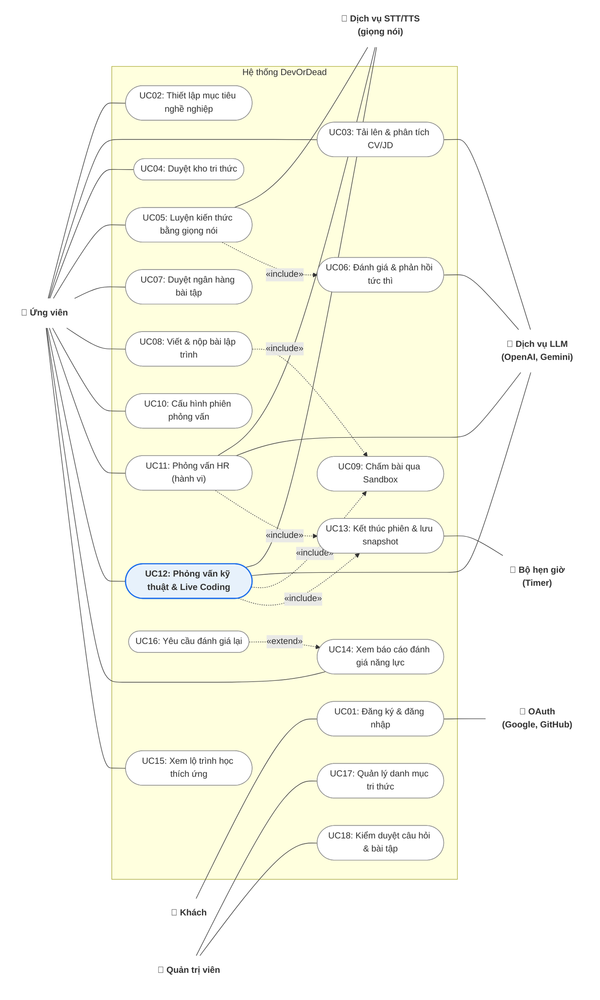
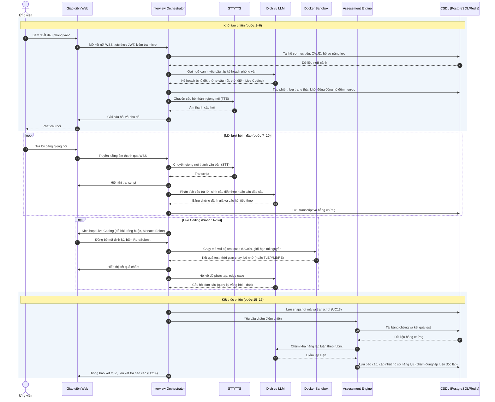

# DevOrDead

**BÁO CÁO PHÂN TÍCH YÊU CẦU PHẦN MỀM**

*Nền tảng luyện tập và mô phỏng phỏng vấn IT cá nhân hóa*

**Học phần:** Nhập môn công nghệ phần mềm (CSC13002)  
**Đơn vị:** Đại học Khoa học Tự Nhiên – ĐHQG-HCM  
**Lớp:** 24_31  
**Nhóm thực hiện:** DevOrDead  
**Giảng viên:** Phạm Minh Tuấn · Ngô Ngọc Đăng Khoa · Trương Phước Lộc  
**Địa điểm, thời gian:** TP. Hồ Chí Minh, tháng 11/2026

### Nhóm thực hiện

| MSSV | Thành viên | Vai trò trong nhóm |
| --- | --- | --- |
| 24120068 | Nguyễn Phúc Khang | Nhóm trưởng; System Architect; AI Integration |
| 24120151 | Phạm Minh Trọng | Kỹ sư Dữ liệu/Voice; QA/Testing |
| 24120103 | Hoàng Trọng Nghĩa | Kỹ sư Fullstack; Thiết kế UI/UX |
| 24120110 | Nguyễn Hoàng Nhật | Kỹ sư Backend Hệ thống; Sandbox Runner; CSDL |

---

## Thông tin và phạm vi tài liệu

Tài liệu trình bày bài toán DevOrDead, bối cảnh nghiệp vụ, khảo sát cạnh tranh, chiến lược triển khai, các bên liên quan, danh sách yêu cầu chức năng/phi chức năng, quy định nghiệp vụ, mô hình use case và bản mẫu giao diện. Nội dung được chuyển đổi từ báo cáo HTML của nhóm, giữ nguyên các mã tham chiếu và thông số kỹ thuật trong nguồn.

| Thành phần | Quy mô ghi nhận trong tài liệu nguồn |
| --- | --- |
| Chương chính | 5 chương, cùng phần Mở đầu |
| Yêu cầu chức năng | F01–F18 |
| Đặc tả use case | UC01–UC18 |
| Biểu đồ UML | 2 biểu đồ Mermaid (use case và tuần tự UC12) |
| Bảng dữ liệu / đặc tả | 32 bảng trong HTML gốc |
| Bản mẫu giao diện | 15 màn hình |

### Quy ước mã tham chiếu

| Ký hiệu | Ý nghĩa |
| --- | --- |
| `Fxx` | Yêu cầu chức năng (Functional Requirement) |
| `UCxx` | Trường hợp sử dụng (Use Case) |
| `NFRxx` | Yêu cầu phi chức năng (Non-Functional Requirement) |
| `BRx` | Quy định nghiệp vụ (Business Rule) |

## Mục lục

- [Mở đầu – Các nội dung chính](#mo-dau)
- [Chương 01 – Bảng đánh giá thành viên](#chuong-01)
- [Chương 02 – Mô tả bài toán](#chuong-02)
- [Chương 03 – Tổng quan yêu cầu](#chuong-03)
- [Chương 04 – Đặc tả yêu cầu](#chuong-04)
- [Chương 05 – Bản mẫu (Prototype)](#chuong-05)
- [Phụ lục A – Ma trận truy vết yêu cầu chức năng và use case](#phu-luc-a)
- [Phụ lục B – Ghi chú về định dạng Markdown](#phu-luc-b)

---

## Mở đầu – Các nội dung chính

Mục tiêu tài liệu tập trung vào các chủ đề:

- Tạo ra tài liệu phân tích yêu cầu
- Hoàn chỉnh tài liệu phân tích yêu cầu với các nội dung:
  - Mô tả phát biểu bài toán
  - Tổng quan về các yêu cầu (chức năng và phi chức năng), Stakeholders.
  - Mô hình use case
  - Đặc tả use case
  - Vẽ mô hình prototype, mockups giao diện của hệ thống
- Đọc hiểu tài liệu phân tích yêu cầu.

---

## Chương 01 – Bảng đánh giá thành viên

| MSSV | Họ Tên | % đóng góp (tối đa 100%) | Chữ ký |
| --- | --- | --- | --- |
| 24120068 | Nguyễn Phúc Khang | 100% |  |
| 24120103 | Hoàng Trọng Nghĩa | 100% |  |
| 24120110 | Nguyễn Hoàng Nhật | 100% |  |
| 24120151 | Phạm Minh Trọng | 100% |  |

---

## Chương 02 – Mô tả bài toán

### 2.1 Nghiệp vụ bài toán

DevOrDead là nền tảng web giúp sinh viên CNTT và lập trình viên mới (Intern, Fresher, Junior dưới 2 năm kinh nghiệm) luyện tập và mô phỏng phỏng vấn kỹ thuật theo đúng vị trí ứng tuyển, bằng giọng nói và viết mã trực tiếp.

**Hiện trạng và vấn đề:** Khi chuẩn bị phỏng vấn, ứng viên thường sẽ gặp các khó khăn chính sau:

1. **Không rõ yêu cầu của vị trí:** không biết vị trí mục tiêu (Backend, Frontend, AI/Data…) ở cấp Intern hay Junior cần nắm khối kiến thức nào, sâu đến đâu.
2. **Công cụ ôn luyện phân mảnh:** giải thuật luyện trên LeetCode/HackerRank, lý thuyết đọc qua blog, câu hỏi phỏng vấn tìm rời rạc trên mạng; không có nơi gắn kết kiến thức, kỹ năng giải bài và kỹ năng giao tiếp.
3. **Thiếu luyện tập trình bày giải pháp bằng lời:** phỏng vấn kỹ thuật đòi hỏi vừa viết mã vừa giải thích tư duy (think aloud), cơ chế bên dưới và so sánh giải pháp; đọc tài liệu hay làm trắc nghiệm không tạo được phản xạ này.
4. **AI chưa đáp ứng dủ:** ChatGPT, Gemini… sinh câu hỏi nhanh nhưng dễ vụn vặt, trùng lặp, không bám JD/CV và không lưu bằng chứng để đánh giá khách quan.

**Quy trình nghiệp vụ của hệ thống:** Ứng viên đăng ký tài khoản, chọn vị trí và cấp độ mục tiêu, có thể tải lên CV và JD để hệ thống trích xuất kỹ năng trọng tâm. Sau đó ứng viên luyện tập theo ba hình thức:

- **Luyện bằng giọng nói:** chọn chủ đề trong cây tri thức, trả lời câu hỏi mở qua micro; hệ thống chuyển giọng nói thành văn bản, chấm độ chính xác và hỏi đào sâu.
- **Luyện lập trình:** giải bài trên editor trực tuyến; code được chạy trong môi trường cách ly (sandbox) và chấm tự động bằng bộ test case.
- **Phỏng vấn mô phỏng với AI:** Phỏng vấn với HR (Tiếng Anh,Behavior, Technical Screen) hoặc Technical kết hợp Live Coding, trao đổi bằng giọng nói thời gian thực, có thời lượng trong khoảng 15–45 phút.

Sau mỗi hoạt động, hệ thống tổng hợp bằng chứng (kết quả test, nội dung trả lời) thành báo cáo năng lực chi tiết và tự điều chỉnh lộ trình học tiếp theo. Ứng viên có thể yêu cầu xem xét lại kết quả nếu thấy AI chấm chưa chính xác. Quản trị viên quản lý và kiểm duyệt câu hỏi, bài tập trước khi đưa vào ngân hàng chính thức.

**Quy định nghiệp vụ chính**

- Phiên phỏng vấn kết thúc đúng thời lượng đã chọn; hệ thống lưu ảnh chụp (snapshot) mã và transcript tại thời điểm hết giờ.
- Tính đúng của mã và khả năng lập luận được chấm độc lập với nhau.
- Mọi mã nguồn người dùng nộp lên được coi là không tin cậy và chỉ chạy trong sandbox.
- Câu hỏi AI sinh trong phiên chỉ dùng tạm thời, không tự động vào ngân hàng câu hỏi chính thức.

### 2.2 Khảo sát đối thủ cạnh tranh

Nhóm khảo sát các nền tảng trực tuyến có sử dụng AI để hỗ trợ chuẩn bị phỏng vấn kỹ thuật, tập trung vào đối tượng sinh viên và lập trình viên mới (Intern, Fresher, Junior). Các tiêu chí khảo sát gồm: đối tượng sử dụng, loại câu hỏi, khả năng phỏng vấn bằng giọng nói, môi trường lập trình trực tuyến, mức độ cá nhân hóa theo CV/JD, phản hồi sau phiên và mô hình chi phí.

| Nền tảng | Phạm vi và điểm nổi bật | Hạn chế đối với nhóm người dùng mục tiêu |
| --- | --- | --- |
| HackerRank – AI Mock Interviews | Mô phỏng nhiều vòng phỏng vấn như Coding, System Design, Frontend/Backend và Behavioral; có giới hạn thời gian, AI phản hồi về mã nguồn, tư duy và giao tiếp. | Thiên về bài toán kỹ thuật có độ khó tương đối cao; chi phí và mức độ tùy chỉnh riêng cho Intern/Fresher chưa rõ ràng. |
| Codecademy – AI Interview Simulator | Hướng đến người học lập trình; cho phép chọn vai trò, cấp độ và kịch bản phỏng vấn; phản hồi theo cấu trúc STAR bằng giọng nói hoặc văn bản. | Chủ yếu là hỏi đáp và kỹ năng hành vi, chưa có môi trường viết mã và chấm bài trực tiếp. |
| Thita.ai – AI Coding Interview | Phỏng vấn coding bằng giọng nói kết hợp IDE, chạy mã với test case, hỏi đào sâu về độ phức tạp và trường hợp biên; có báo cáo theo rubric. | Tập trung chủ yếu vào DSA/coding; giới hạn miễn phí thấp, giao diện tiếng Anh và gói trả phí có thể chưa phù hợp ngân sách sinh viên. |
| Practers | Kết hợp AI mock interview, live coding, peer-to-peer interview, chuyên gia phỏng vấn, contest, phân tích CV và AI tutor. | Phạm vi chức năng lớn có thể gây quá tải cho người mới; thông tin giá và chính sách xử lý dữ liệu chưa thật sự rõ ràng. |
| Interviews by AI / Interview.co | Tập trung vào kỹ năng giao tiếp, phỏng vấn hành vi, tạo câu hỏi theo vai trò hoặc JD, ghi âm/video và phản hồi về cấu trúc câu trả lời. | Không có khả năng luyện thuật toán và chấm mã trong sandbox; độ sâu câu hỏi kỹ thuật còn hạn chế. |
| HelloInterview | Mô phỏng System Design với whiteboard, AI hỏi đào sâu, báo cáo theo năng lực và đánh giá Hire/No Hire. | Nội dung hướng nhiều đến kỹ sư mid/senior; không phù hợp làm trọng tâm ôn luyện cho Intern/Fresher. |
| Final Round AI | Hỗ trợ nhiều loại vòng phỏng vấn, cá nhân hóa theo resume/JD, có báo cáo sau phiên và các công cụ hỗ trợ CV. | Là sản phẩm thương mại đa lĩnh vực, chưa tập trung riêng vào lộ trình luyện kỹ thuật có chấm code độc lập cho sinh viên CNTT. |

**Kết quả khảo sát:** Các nền tảng hiện có thường mạnh ở một hoặc một vài khía cạnh: HackerRank và Thita.ai chú trọng coding; Codecademy, Interviews by AI và Interview.co chú trọng kỹ năng giao tiếp; HelloInterview chuyên về System Design; còn Practers và Final Round AI cung cấp nhiều chức năng trong một hệ thống. Tuy nhiên, phần lớn sản phẩm chưa đồng thời đáp ứng tốt ba nhu cầu của sinh viên CNTT: luyện trả lời kỹ thuật bằng giọng nói, live coding có chấm test case an toàn và lộ trình học thích ứng theo mục tiêu ứng tuyển.

**Định vị của DevOrDead:** DevOrDead kế thừa các điểm phù hợp từ kết quả khảo sát: cá nhân hóa nội dung theo Role, Level, CV và JD; mô phỏng phỏng vấn bằng giọng nói; editor hỗ trợ live coding; báo cáo phản hồi sau phiên. Điểm khác biệt của hệ thống là tách riêng việc đánh giá tính đúng của mã và khả năng lập luận, sử dụng sandbox để chấm mã không tin cậy, đồng thời duy trì ngân hàng câu hỏi/bài tập có kiểm duyệt. Phạm vi này phù hợp với sinh viên CNTT, Intern, Fresher và Junior trong điều kiện thời gian, chi phí của đồ án.

### 2.3 Chiến lược kinh doanh

**Phân khúc khách hàng mục tiêu:** DevOrDead tập trung trước hết vào sinh viên CNTT năm cuối, Intern, Fresher và Junior có dưới 2 năm kinh nghiệm tại Việt Nam. Đây là nhóm có nhu cầu luyện phỏng vấn cao nhưng thường thiếu kinh nghiệm thực tế, không có người luyện cùng thường xuyên và nhạy cảm với chi phí. Trong giai đoạn sau, hệ thống có thể mở rộng cho các câu lạc bộ CNTT, trung tâm đào tạo và doanh nghiệp muốn chuẩn hóa hoạt động chuẩn bị phỏng vấn đầu vào.

**Giá trị mang lại:** Thay vì yêu cầu người dùng sử dụng nhiều công cụ rời rạc, DevOrDead kết hợp luyện kiến thức bằng giọng nói, viết mã trên editor, chấm bài qua sandbox và phỏng vấn mô phỏng bằng AI trong một luồng học tập thống nhất. Hệ thống cá nhân hóa nội dung theo Role, Level, CV và JD, sau đó sử dụng kết quả thực tế để đề xuất nội dung cần cải thiện. Giá trị cốt lõi là giúp người học biết rõ mình yếu ở kiến thức, kỹ năng lập luận hay kỹ năng giao tiếp, thay vì chỉ nhận một điểm tổng quát.

**Mô hình tiếp cận và doanh thu:** Trong phạm vi đồ án, hệ thống được cung cấp miễn phí cho nhóm người dùng thử nghiệm để thu thập phản hồi và kiểm chứng nhu cầu. Nếu phát triển thành sản phẩm, DevOrDead áp dụng mô hình Freemium:

- **Gói miễn phí:** tạo hồ sơ mục tiêu, duyệt kho tri thức, luyện một số bài coding và số lượng giới hạn phiên phỏng vấn AI mỗi tháng.
- **Gói Premium dành cho cá nhân:** mở rộng số phiên phỏng vấn AI, phân tích CV/JD, báo cáo năng lực chi tiết, lộ trình học thích ứng và lịch sử luyện tập dài hạn. Mức phí cần phù hợp với khả năng chi trả của sinh viên Việt Nam.
- **Gói cho tổ chức:** cung cấp tài khoản theo nhóm cho câu lạc bộ, trung tâm đào tạo hoặc doanh nghiệp; tổ chức có thể theo dõi tiến độ tổng hợp nhưng không truy cập nội dung CV, transcript hay mã nguồn cá nhân nếu chưa có sự đồng ý của người dùng.

**Kênh tiếp cận khách hàng:** Giai đoạn đầu ưu tiên các kênh có chi phí thấp và tiếp cận đúng tệp người dùng: câu lạc bộ học thuật, khoa CNTT tại trường đại học, cộng đồng lập trình viên, GitHub, LinkedIn và các buổi workshop hướng dẫn chuẩn bị phỏng vấn. Người dùng miễn phí được khuyến khích chia sẻ báo cáo tiến bộ hoặc mời bạn cùng luyện tập; phản hồi từ các đợt dùng thử được dùng để cải thiện ngân hàng câu hỏi, trải nghiệm phỏng vấn và độ chính xác của đánh giá AI.

**Chiến lược triển khai theo giai đoạn:** Trong 12 tuần của đồ án, nhóm ưu tiên hoàn thiện luồng giá trị cốt lõi gồm thiết lập mục tiêu, luyện kiến thức, live coding có sandbox, phỏng vấn mô phỏng và báo cáo sau phiên. Các tính năng tiêu tốn nhiều chi phí API như số lượng lớn phiên AI, avatar, video hoặc cố vấn người thật chỉ được xem là hướng mở rộng sau khi xác nhận người dùng sẵn sàng trả phí. Chi phí hạ tầng và AI được kiểm soát bằng hạn mức phiên, sử dụng mô hình có chi phí phù hợp và tận dụng các gói hỗ trợ sinh viên.

**Chỉ số đánh giá ban đầu:** Nhóm đánh giá hiệu quả sản phẩm qua số người hoàn thành phiên luyện tập, tỷ lệ quay lại luyện tập, số bài nộp hoặc phiên phỏng vấn hoàn tất, mức cải thiện giữa các báo cáo năng lực và phản hồi hài lòng của người dùng. Các chỉ số này được dùng để xác định tính hữu ích của sản phẩm trước khi mở rộng mô hình trả phí.

### 2.4 Môi trường hoạt động

Hệ thống là ứng dụng web, người dùng truy cập qua trình duyệt trên máy tính; phần xử lý chạy trên máy chủ Linux và gọi các dịch vụ AI, giọng nói trên đám mây.

| Thành phần | Môi trường yêu cầu |
| --- | --- |
| Phía người dùng | Trình duyệt hỗ trợ HTML5, CSS3, ES6+, Web Audio API, MediaDevices API, WebSocket (Chrome, Edge, Firefox bản 100 trở lên; Safari 15 trở lên). Máy tính có micro và loa/tai nghe; Internet tối thiểu 5 Mbps. |
| Máy chủ ứng dụng | Linux Ubuntu 22.04 LTS hoặc Debian 12; Node.js (v18.x hoặc v20.x LTS) hoặc Python (v3.10+) với FastAPI và ASGI server Uvicorn. |
| Web server, reverse proxy | Nginx: phục vụ tệp tĩnh, kết thúc SSL/TLS (HTTPS), chuyển tiếp REST API và kết nối WebSocket (WSS). |
| Môi trường chấm mã | Docker Engine (v24+) với cgroups v2 và lớp bảo mật bổ sung gVisor/nsjail; container dựng sẵn Python 3.11, Node.js 20, GCC/G++ 12 (C/C++), OpenJDK 17 (Java). |
| Dịch vụ AI | API mô hình ngôn ngữ lớn của OpenAI (GPT-4o, GPT-4o-mini) hoặc Google Gemini 1.5 Pro / Flash, giao tiếp RESTful API và Server-Sent Events (SSE). |
| Dịch vụ giọng nói | Web Speech API của trình duyệt, kết hợp dịch vụ Speech-to-Text / Text-to-Speech đám mây (OpenAI Whisper, Deepgram, Google Cloud Speech). |
| Cơ sở dữ liệu | PostgreSQL 15+ lưu dữ liệu người dùng, bài tập, bài nộp, báo cáo; Redis 7+ lưu phiên làm việc, pub/sub trạng thái phòng phỏng vấn. |

### 2.5 Các ràng buộc về thiết kế và triển khai

Hệ thống phải được xây dựng bằng công nghệ web mã nguồn mở, chạy mã người dùng trong sandbox cách ly và hoàn thành trong 12 tuần với ngân sách khoảng 1.700.000 VNĐ.

- **Kiến trúc:** tách biệt Frontend (Single Page Application) và Backend (RESTful API và WebSocket Gateway). Các phân hệ Tài khoản, Luyện tập kiến thức, Chấm mã và Phỏng vấn AI được đóng gói thành mô-đun độc lập để dễ bảo trì, mở rộng.
- **Ngôn ngữ và công nghệ:** Frontend dùng React/Next.js và trình soạn thảo Monaco Editor; Backend dùng Node.js hoặc Python (FastAPI). Trình soạn thảo hỗ trợ tô màu cú pháp, đánh số dòng, tự thụt lề và chỉnh cỡ chữ cho Python, JavaScript, C++, Java.
- **Cơ sở dữ liệu:** PostgreSQL là CSDL quan hệ chính; Redis dùng cho bộ nhớ đệm, phiên làm việc và hàng đợi. Lược đồ CSDL được chuẩn hóa và có chỉ mục cho các truy vấn thường dùng.
- **An toàn sandbox:** code của người dùng không bao giờ chạy trực tiếp trên máy chủ chính. Mỗi lần chạy dùng một container riêng, hủy ngay sau khi chấm, giới hạn tối đa 1 CPU, 256 MB RAM, 50 MB tệp tạm, 3–5 giây mỗi test case; tắt hoàn toàn mạng, hệ thống tệp gốc chỉ đọc, chỉ ghi vào /tmp. Vi phạm trả về mã lỗi TLE, MLE hoặc Runtime Error.
- **Độ trễ và trải nghiệm:** trong phỏng vấn bằng giọng nói, thời gian từ lúc ứng viên dứt câu đến khi AI bắt đầu phản hồi không quá 2,5 giây.
- **Bảo mật và quyền riêng tư:** mọi dữ liệu truyền qua HTTPS/WSS; xác thực bằng JWT và OAuth2 (Google, GitHub); dữ liệu CV/JD được mã hóa khi lưu trữ; không dùng dữ liệu người dùng để huấn luyện mô hình khi chưa có sự đồng ý.
- **Triển khai:** toàn hệ thống đóng gói bằng Docker Compose, triển khai trên VPS (2 vCPU, 4 GB RAM); mã nguồn quản lý trên GitHub, kiểm thử tự động bằng GitHub Actions.
- **Chuẩn tài liệu và quy trình:** phát triển theo mô hình thác nước (Waterfall) qua 5 giai đoạn; tài liệu đặc tả yêu cầu theo IEEE 830 (SRS); biểu đồ theo UML 2.0 (Use Case, Class, Sequence); tài liệu API theo OpenAPI/Swagger; trình bày theo biểu mẫu của Bộ môn Công nghệ Phần mềm.
- **Thời gian và ngân sách:** hoàn thành trong 12 tuần của học kỳ; chi phí API và máy chủ được kiểm soát theo hạn mức, tận dụng gói GitHub Student Developer Pack và các gói miễn phí cho sinh viên.

---

## Chương 03 – Tổng quan yêu cầu

### 3.1 Danh sách các stakeholder

| STT | Stakeholder | Mô tả |
| --- | --- | --- |
| 1 | Ứng viên (Sinh viên IT, fresher, junior) | Người dùng chính. Đăng ký tài khoản, thiết lập mục tiêu nghề nghiệp, tải CV/JD, luyện tập kiến thức bằng giọng nói, luyện code, phỏng vấn thử với AI, xem báo cáo năng lực và lộ trình học. |
| 2 | Khách (người chưa có tài khoản) | Người truy cập hệ thống khi chưa đăng nhập; chỉ được đăng ký hoặc đăng nhập. |
| 3 | Quản trị viên / Curator | Quản lý cây tri thức (taxonomy), bộ năng lực theo ngành; kiểm duyệt câu hỏi và bài tập do AI đề xuất trước khi đưa vào ngân hàng chính thức. |
| 4 | Nhà cung cấp OAuth (Google, GitHub) | Hệ thống ngoài xác thực danh tính khi người dùng đăng nhập bằng OAuth2. |
| 5 | Nhà cung cấp dịch vụ LLM (OpenAI/Gemini) | Hệ thống ngoài phân tích CV/JD, đánh giá câu trả lời, điều phối hội thoại và chấm lập luận trong phỏng vấn. |
| 6 | Nhà cung cấp dịch vụ giọng nói STT/TTS | Hệ thống ngoài chuyển giọng nói thành văn bản và ngược lại (Web Speech API, Whisper, Deepgram, Google Cloud Speech). |
| 7 | Bộ hẹn giờ (Timer) | Thành phần thời gian kích hoạt kết thúc phiên phỏng vấn khi hết thời lượng (hard-stop). |
| 8 | Nhà tuyển dụng / doanh nghiệp | Gián tiếp: yêu cầu trong JD là chuẩn tham chiếu để hệ thống cá nhân hóa nội dung ôn luyện. |
| 9 | Nhóm phát triển & vận hành | Xây dựng, triển khai và bảo trì hệ thống; chịu trách nhiệm hạ tầng máy chủ, Sandbox và chi phí API. |
| 10 | Giảng viên môn học | Đánh giá đồ án theo chuẩn tài liệu của Bộ môn Công nghệ Phần mềm. |

### 3.2 Danh sách yêu cầu

#### 3.2.1 Đặc tả yêu cầu chức năng

##### I. Quản lý tài khoản & hồ sơ mục tiêu

| User Story | Requirement | Details |
| --- | --- | --- |
| **F01** – Là một Khách, tôi muốn đăng ký và đăng nhập bằng Email/Password hoặc tài khoản Google/GitHub để có tài khoản cá nhân lưu lại tiến trình luyện tập của mình. | Đăng ký & đăng nhập | Hỗ trợ xác thực bằng Email/Password và OAuth2 (Google, GitHub). Đây là chức năng duy nhất truy cập được khi chưa đăng nhập; mọi chức năng còn lại đều yêu cầu đăng nhập. |
| **F02** – Là một Ứng viên, tôi muốn chọn vị trí (Role) và cấp độ (Level) mục tiêu để nội dung ôn luyện bám sát vị trí tôi đang ứng tuyển. | Thiết lập mục tiêu nghề nghiệp | Chọn Role mục tiêu (Backend, Frontend, Fullstack, AI Engineer...) và Level (Intern, Fresher, Junior). Lựa chọn quyết định cây kiến thức và ngân hàng bài tập được đề xuất. |
| **F03** – Là một Ứng viên, tôi muốn tải lên CV và JD của vị trí mình nhắm tới để hệ thống tùy biến câu hỏi theo kỹ năng thực tế mà nhà tuyển dụng cần. | Tải lên và phân tích CV/JD | Tải CV và văn bản JD; hệ thống trích xuất công nghệ, kỹ năng trọng tâm để tùy biến nội dung ôn luyện. CV/JD được mã hóa khi lưu trữ (NFR04). |

##### II. Luyện tập kiến thức bằng giọng nói

| User Story | Requirement | Details |
| --- | --- | --- |
| **F04** – Là một Ứng viên, tôi muốn duyệt cây kiến thức theo Domain, Topic và Competency để biết cần ôn những gì và chọn đúng chủ đề muốn luyện. | Khám phá kho tri thức | Duyệt cây kiến thức theo ba cấp Domain → Topic → Competency, được lọc theo Role/Level đã thiết lập ở F02. |
| **F05** – Là một Ứng viên, tôi muốn nghe hoặc đọc câu hỏi kỹ thuật mở và trả lời bằng giọng nói để làm quen với cách diễn đạt khi phỏng vấn thật. | Luyện trả lời bằng giọng nói | Nghe/đọc câu hỏi kỹ thuật mở và trả lời qua micro theo lượt (turn-based). Độ trễ phản hồi bằng giọng nói không vượt quá 2,5 giây (NFR01). |
| **F06** – Là một Ứng viên, tôi muốn xem transcript và nhận phản hồi ngay sau mỗi câu trả lời để biết mình đúng/sai ở đâu và được hỏi đào sâu thêm. | Đánh giá và phản hồi tức thì | Hiển thị transcript, phân tích điểm đúng/sai về kỹ thuật và câu hỏi đào sâu (follow-up) sau mỗi câu trả lời. |

##### III. Luyện tập lập trình & chấm điểm Sandbox

| User Story | Requirement | Details |
| --- | --- | --- |
| **F07** – Là một Ứng viên, tôi muốn duyệt bài tập theo mức độ khó, chủ đề thuật toán và vai trò tuyển dụng để chọn bài phù hợp với trình độ và mục tiêu của mình. | Danh mục bài tập lập trình | Duyệt và lọc bài tập theo mức độ khó, chủ đề thuật toán và vai trò tuyển dụng. Chỉ hiển thị bài đã được Admin phê duyệt (BR4). |
| **F08** – Là một Ứng viên, tôi muốn viết code ngay trên trình duyệt bằng ngôn ngữ quen thuộc để luyện tập mà không phải cài đặt môi trường. | Trình soạn thảo mã trực tuyến | Editor trên trình duyệt hỗ trợ Python, JavaScript, C++, Java; có syntax highlighting, line numbering, auto indentation, chỉnh cỡ chữ. |
| **F09** – Là một Ứng viên, tôi muốn chạy thử và nộp bài để được chấm tự động bằng bộ test case, biết ngay kết quả, thời gian chạy và bộ nhớ sử dụng. | Chấm bài tự động qua Sandbox | Chạy thử (Run) và nộp bài (Submit); chấm bằng bộ test case trong Docker Sandbox, trả về kết quả, thời gian chạy, bộ nhớ. Giới hạn: 1 CPU, 256 MB RAM, 50 MB tệp tạm, timeout 3–5 giây/test case, không có mạng, root filesystem chỉ đọc (NFR02, BR3). Vi phạm trả về mã lỗi cụ thể (TLE, MLE, Runtime Error). |

##### IV. Mô phỏng phỏng vấn AI thời gian thực

| User Story | Requirement | Details |
| --- | --- | --- |
| **F10** – Là một Ứng viên, tôi muốn chọn loại phỏng vấn, thời lượng và độ khó để buổi mô phỏng phù hợp với mục tiêu và quỹ thời gian của mình. | Cấu hình phiên phỏng vấn | Chọn loại (HR/Technical), thời lượng (15/30/45 phút) và độ khó trước khi bắt đầu phiên. |
| **F11** – Là một Ứng viên, tôi muốn trò chuyện bằng giọng nói với AI về dự án và các câu hỏi hành vi bằng tiếng Anh để luyện phản xạ và cách kể chuyện theo mô hình STAR. | Phỏng vấn tiếng Anh & ứng xử | Đối thoại bằng giọng nói thời gian thực với AI về kinh nghiệm dự án, câu hỏi hành vi (STAR). Độ trễ phản hồi ≤ 2,5 giây (NFR01). |
| **F12** – Là một Ứng viên, tôi muốn vừa giải thích thuật toán bằng giọng nói vừa viết code trên editor trong buổi phỏng vấn để trải nghiệm đúng một buổi phỏng vấn kỹ thuật có live coding. | Phỏng vấn kỹ thuật & Live Coding | Trao đổi thuật toán bằng giọng nói kết hợp viết code trên editor; AI kích hoạt bài Live Coding và hỏi về tư duy. Tính đúng của mã và khả năng lập luận được chấm độc lập (BR2). |
| **F13** – Là một Ứng viên, tôi muốn phiên phỏng vấn tự kết thúc đúng thời lượng và được lưu lại toàn bộ code, transcript để có dữ liệu xem lại và đánh giá sau đó. | Quản lý thời lượng & snapshot phiên | Tự động kết thúc đúng thời lượng, lưu snapshot mã nguồn và transcript. Không cho kéo dài phiên (BR1); có thể tiếp tục ở chế độ Practice mà không đổi điểm phiên. |

##### V. Đánh giá năng lực & lộ trình thích ứng

| User Story | Requirement | Details |
| --- | --- | --- |
| **F14** – Là một Ứng viên, tôi muốn nhận báo cáo chi tiết sau buổi phỏng vấn để hiểu điểm mạnh, điểm yếu của mình và biết cần cải thiện điều gì. | Báo cáo đánh giá năng lực chi tiết | Báo cáo sau phỏng vấn gồm transcript, điểm mạnh/yếu, đánh giá theo competency và đề xuất cải thiện. |
| **F15** – Là một Ứng viên, tôi muốn có lộ trình học tự điều chỉnh theo kết quả làm bài thực tế để tập trung đúng vào phần mình còn yếu. | Lộ trình học tập phù hợp | Tự cập nhật độ ưu tiên và độ khó bài tập dựa trên bằng chứng từ kết quả làm bài thực tế (evidence-based). |
| **F16** – Là một Ứng viên, tôi muốn gửi yêu cầu chấm lại kèm lý do khi thấy kết quả của AI chưa thỏa đáng để đảm bảo đánh giá công bằng. | Yêu cầu xem xét lại kết quả | Gửi yêu cầu đánh giá lại (re-evaluation) kèm lý do nếu thấy AI chấm chưa thỏa đáng. |

##### VI. Quản trị & kiểm duyệt nội dung (Admin)

| User Story | Requirement | Details |
| --- | --- | --- |
| **F17** – Là một Quản trị viên, tôi muốn quản lý taxonomy, thêm/bớt chủ đề và chuẩn hóa bộ năng lực theo ngành nghề để kho tri thức luôn có cấu trúc nhất quán và cập nhật. | Quản lý danh mục tri thức | Quản lý taxonomy, thêm/bớt chủ đề, chuẩn hóa bộ năng lực theo ngành nghề. |
| **F18** – Là một Quản trị viên, tôi muốn xem xét, chỉnh sửa và phê duyệt câu hỏi, bài tập do AI đề xuất để chỉ nội dung chất lượng mới vào ngân hàng chính thức. | Kiểm duyệt ngân hàng câu hỏi & bài tập | Phê duyệt, chỉnh sửa câu hỏi và bài tập do AI đề xuất trước khi đưa vào ngân hàng chính thức (human-in-the-loop, BR4). |

##### Các quy định nghiệp vụ (Business Rules)

| Mã | Quy định | Nội dung |
| --- | --- | --- |
| BR1 | Hard-stop | Phiên phỏng vấn kết thúc chính xác theo thời lượng đã chọn, không cho kéo dài; hệ thống lưu snapshot mã và transcript tại thời điểm đó. Người dùng có thể làm tiếp ở chế độ Practice mà không thay đổi điểm phiên. |
| BR2 | Tách điểm đúng đắn và lập luận | Tính đúng của mã (pass test case) và khả năng lập luận thuật toán (giải thích qua voice) được chấm độc lập. |
| BR3 | Zero-trust Sandbox | Mọi mã nộp lên đều không tin cậy; container tồn tại chỉ trong thời gian chấm và bị hủy ngay sau đó; vi phạm giới hạn bị ngắt với mã lỗi cụ thể (TLE, MLE, Runtime Error). |
| BR4 | Kiểm duyệt nội dung | Ngân hàng câu hỏi chính thức phải do Admin phê duyệt; câu hỏi AI sinh theo CV/JD trong phiên chỉ có giá trị tạm thời, không tự động vào kho dùng chung. |

#### 3.2.2 Đặc tả yêu cầu phi chức năng

| Mã | Nhóm | Yêu cầu |
| --- | --- | --- |
| NFR01 | Hiệu năng / độ trễ | Trong phỏng vấn bằng giọng nói, độ trễ từ lúc ứng viên dứt câu đến lúc AI bắt đầu phản hồi bằng âm thanh không vượt quá 2,5 giây. |
| NFR02 | An toàn Sandbox | Mã người dùng chỉ chạy trong Docker container cô lập: tối đa 1 CPU core, 256 MB RAM, 50 MB tệp tạm, timeout 3–5 giây/test case, không truy cập mạng, root filesystem chỉ đọc (chỉ ghi được trong `/tmp`, dọn sau mỗi phiên chấm). |
| NFR03 | Bảo mật truyền tải | Toàn bộ dữ liệu giữa máy khách và máy chủ được mã hóa qua HTTPS/WSS. |
| NFR04 | Quyền riêng tư | CV/JD của người dùng được mã hóa tại tầng lưu trữ (encryption at rest); không dùng dữ liệu riêng tư để huấn luyện mô hình khi chưa có sự đồng thuận rõ ràng. |
| NFR05 | Khả dụng & tương thích | Ứng dụng web chạy trên Chrome/Edge/Firefox 100+ và Safari 15+ (HTML5, Web Audio API, MediaDevices API, WebRTC); yêu cầu microphone và kết nối mạng tối thiểu 5 Mbps. |
| NFR06 | Tính mô-đun & bảo trì | Kiến trúc tách Frontend SPA và Backend (REST API + WebSocket); các phân hệ Quản lý người dùng, Luyện tập kiến thức, Thực thi mã, Phỏng vấn AI được đóng gói độc lập. |
| NFR07 | Độ tin cậy | Mất kết nối trong phiên phỏng vấn không làm mất dữ liệu: trạng thái phiên được giữ trong Redis, cho phép kết nối lại; lỗi LLM/STT/TTS được thử lại và chuyển sang dịch vụ dự phòng. |
| NFR08 | Khả năng sử dụng | Trình soạn thảo mã có đầy đủ tiện ích cơ bản; giao diện hiển thị waveform ghi âm và phụ đề cho câu hỏi của AI. |
| NFR09 | Tuân thủ chuẩn tài liệu | Tài liệu tuân thủ UML 2.0 và chuẩn đặc tả yêu cầu IEEE 830 (SRS) theo biểu mẫu của Bộ môn. |
| NFR10 | Ràng buộc môn học | Hoàn thành trong 12 tuần của học kỳ; chi phí API và hạ tầng phù hợp ngân sách học tập của nhóm. |

---

## Chương 04 – Đặc tả yêu cầu

### 4.1 Sơ đồ Use Case

Hệ thống có 3 tác nhân chính (Khách, Ứng viên, Quản trị viên) và 4 tác nhân phụ là hệ thống ngoài hoặc thời gian. 18 use case UC01–UC18 tương ứng một–một với các chức năng F01–F18; UC12 được tô màu là use case được đặc tả chi tiết ở mục 4.2.

Đường liền là liên kết tác nhân – use case; mũi tên đứt là quan hệ «include» (bắt buộc gọi) và «extend» (tùy chọn mở rộng). Mọi use case trừ UC01 đều yêu cầu đã đăng nhập. Docker Sandbox là thành phần bên trong hệ thống nên không vẽ thành tác nhân.

| Tác nhân | Loại | Vai trò |
| --- | --- | --- |
| Khách | Chính | Người chưa có tài khoản; đăng ký, đăng nhập (UC01). |
| Ứng viên | Chính | Sinh viên IT, fresher, junior luyện tập và phỏng vấn thử (UC02–UC15). |
| Quản trị viên | Chính | Quản lý cây tri thức, kiểm duyệt câu hỏi và bài tập (UC17–UC18). |
| OAuth (Google, GitHub) | Phụ – hệ thống ngoài | Xác thực khi đăng nhập bằng OAuth2. |
| Dịch vụ LLM | Phụ – hệ thống ngoài | Phân tích CV/JD, đánh giá câu trả lời, điều phối hội thoại phỏng vấn. |
| Dịch vụ STT/TTS | Phụ – hệ thống ngoài | Chuyển giọng nói thành văn bản và ngược lại. |
| Bộ hẹn giờ | Phụ – thời gian | Kích hoạt kết thúc phiên khi hết thời lượng (hard-stop). |

### 4.2 Đặc tả Use Case

Mỗi use case trong 18 use case UC01–UC18 được đặc tả theo cùng một biểu mẫu. UC12 được trình bày đầy đủ nhất (kèm biểu đồ tuần tự) vì đây là tính năng cốt lõi của DevOrDead, các phân hệ của hệ thống đều tham gia vào use case này.

#### 4.2.1 UC01 — Đăng ký & đăng nhập

**Mã use case:** `UC01`  
**Yêu cầu chức năng liên kết:** `F01`

**Tóm tắt:** Khách tạo tài khoản mới hoặc đăng nhập vào hệ thống bằng Email/Password hoặc OAuth2 (Google, GitHub) để lưu trữ dữ liệu học tập cá nhân.

**Tác nhân:** Chính: Khách. Phụ: OAuth (Google, GitHub).

**Điều kiện tiên quyết:** Người dùng chưa đăng nhập và truy cập được trang đăng nhập/đăng ký.

**Kết quả:**

- **Thành công:** tài khoản được tạo (nếu đăng ký) hoặc xác thực thành công; hệ thống cấp JWT và tạo phiên làm việc; người dùng được chuyển tới trang chính. Nếu chưa có Role/Level thì được hướng tới UC02.
- **Thất bại:** không tạo phiên; hiển thị thông báo lỗi.

**Kịch bản chính:**

1. Khách chọn "Đăng ký" hoặc "Đăng nhập".
2. Khách nhập email và mật khẩu (khi đăng ký có thêm bước xác nhận mật khẩu).
3. Hệ thống kiểm tra tính hợp lệ của dữ liệu nhập.
4. Đăng ký: hệ thống kiểm tra email chưa tồn tại và tạo tài khoản, mật khẩu được lưu dưới dạng băm. Đăng nhập: hệ thống đối chiếu thông tin xác thực.
5. Hệ thống cấp JWT và tạo phiên làm việc.
6. Hệ thống chuyển người dùng tới trang chính (dashboard).

**Kịch bản phụ / luồng thay thế và ngoại lệ:**

- **A1:** Đăng nhập bằng OAuth (bước 2). Khách chọn Google hoặc GitHub; hệ thống chuyển hướng sang OAuth, người dùng ủy quyền, hệ thống nhận thông tin định danh, tạo mới hoặc liên kết tài khoản rồi tiếp tục bước 5.
- **E1:** Email đã tồn tại (bước 4). hệ thống báo lỗi và gợi ý đăng nhập.
- **E2:** Sai thông tin đăng nhập (bước 4). hệ thống báo lỗi chung, không tiết lộ email hay mật khẩu sai.
- **E3:** OAuth từ chối hoặc lỗi (A1). hệ thống thông báo và cho phép chọn phương thức khác.

**Ràng buộc phi chức năng:**

- NFR03: dữ liệu xác thực truyền qua HTTPS.
- Mật khẩu không được lưu dạng văn bản thuần; phiên dùng JWT.

#### 4.2.2 UC02 — Thiết lập mục tiêu nghề nghiệp

**Mã use case:** `UC02`  
**Yêu cầu chức năng liên kết:** `F02`

**Tóm tắt:** Ứng viên chọn Role mục tiêu (Backend, Frontend, Fullstack, AI Engineer...) và Level (Intern, Fresher, Junior) để hệ thống định hình kho tri thức và lộ trình học.

**Tác nhân:** Chính: Ứng viên.

**Điều kiện tiên quyết:** Ứng viên đã đăng nhập (UC01).

**Kết quả:**

- **Thành công:** Role và Level được lưu vào hồ sơ mục tiêu; lộ trình ban đầu được khởi tạo theo Role/Level.
- **Thất bại:** hồ sơ mục tiêu giữ nguyên giá trị cũ.

**Kịch bản chính:**

1. Ứng viên mở trang "Hồ sơ mục tiêu".
2. Hệ thống hiển thị danh sách Role (theo Role Family) và Level.
3. Ứng viên chọn Role và Level.
4. Ứng viên xác nhận lưu.
5. Hệ thống kiểm tra và lưu hồ sơ mục tiêu.
6. Hệ thống khởi tạo hoặc cập nhật lộ trình theo mục tiêu mới (UC15) và thông báo thành công.

**Kịch bản phụ / luồng thay thế và ngoại lệ:**

- **A1:** Đổi mục tiêu về sau. ứng viên chọn lại Role/Level; hệ thống cập nhật hồ sơ, lộ trình được điều chỉnh, dữ liệu luyện tập cũ vẫn được giữ.
- **A2:** Bỏ qua bước thiết lập. ứng viên vẫn dùng được các chức năng luyện tập chung; hệ thống nhắc thiết lập, và chưa cho bắt đầu phiên phỏng vấn cho đến khi có Role/Level (xem UC10).
- **E1:** Lỗi lưu dữ liệu (bước 5). hệ thống báo lỗi và cho thử lại.

**Ràng buộc phi chức năng:** Danh sách Role/Level lấy từ cây tri thức do Quản trị viên quản lý (UC17).

#### 4.2.3 UC03 — Tải lên & phân tích CV/JD

**Mã use case:** `UC03`  
**Yêu cầu chức năng liên kết:** `F03`

**Tóm tắt:** Ứng viên tải lên CV và văn bản JD của công ty mục tiêu; hệ thống trích xuất công nghệ, kỹ năng trọng tâm để cá nhân hóa nội dung ôn luyện và phỏng vấn.

**Tác nhân:** Chính: Ứng viên. Phụ: Dịch vụ LLM.

**Điều kiện tiên quyết:** Ứng viên đã đăng nhập (UC01).

**Kết quả:**

- **Thành công:** CV/JD được lưu (mã hóa) cùng danh sách kỹ năng trích xuất; dữ liệu này được dùng làm ngữ cảnh cho UC04, UC05, UC10–UC12.
- **Thất bại:** không lưu ngữ cảnh mới.

**Kịch bản chính:**

1. Ứng viên chọn "Tải lên CV/JD".
2. Ứng viên chọn tệp CV và/hoặc nhập, dán văn bản JD.
3. Hệ thống kiểm tra định dạng và kích thước tệp.
4. Hệ thống trích xuất nội dung văn bản.
5. Hệ thống gửi nội dung tới Dịch vụ LLM để trích xuất kỹ năng, công nghệ và mức độ yêu cầu.
6. Hệ thống hiển thị kết quả để ứng viên xem lại.
7. Ứng viên xác nhận; hệ thống lưu CV/JD (mã hóa) và kết quả phân tích.

**Kịch bản phụ / luồng thay thế và ngoại lệ:**

- **A1:** Chỉnh sửa kết quả (bước 6). ứng viên thêm, bớt hoặc sửa kỹ năng trước khi xác nhận.
- **A2:** Thay hoặc xóa CV/JD đã lưu. hệ thống thay thế hoặc xóa dữ liệu và ngữ cảnh liên quan.
- **E1:** Tệp sai định dạng hoặc quá lớn (bước 3). hệ thống báo lỗi và yêu cầu chọn lại.
- **E2:** Không trích xuất được văn bản (bước 4). hệ thống báo lỗi, đề nghị dán văn bản trực tiếp.
- **E3:** LLM lỗi hoặc quá thời gian chờ (bước 5). hệ thống thử lại; nếu vẫn lỗi, ứng viên có thể nhập kỹ năng thủ công.

**Ràng buộc phi chức năng:**

- NFR04: CV/JD được mã hóa tại tầng lưu trữ; không dùng để huấn luyện mô hình khi chưa có đồng thuận rõ ràng.
- NFR03: truyền qua HTTPS.

#### 4.2.4 UC04 — Duyệt kho tri thức

**Mã use case:** `UC04`  
**Yêu cầu chức năng liên kết:** `F04`

**Tóm tắt:** Ứng viên duyệt cây kiến thức theo Domain, Topic và Competency để chọn nội dung cần ôn tập.

**Tác nhân:** Chính: Ứng viên.

**Điều kiện tiên quyết:** Ứng viên đã đăng nhập (UC01).

**Kết quả:**

- **Thành công:** ứng viên xem được Topic mong muốn và có thể bắt đầu luyện tập (UC05).
- **Thất bại:** không có thay đổi dữ liệu.

**Kịch bản chính:**

1. Ứng viên mở "Kho tri thức".
2. Hệ thống hiển thị cây Domain → Topic → Competency, lọc theo Role/Level mục tiêu và ưu tiên kỹ năng lấy từ CV/JD (nếu có).
3. Ứng viên duyệt, tìm kiếm hoặc lọc cây tri thức.
4. Ứng viên chọn một Topic; hệ thống hiển thị mô tả, các Competency và tiến độ luyện tập.
5. Ứng viên chọn "Bắt đầu luyện" để chuyển sang UC05.

**Kịch bản phụ / luồng thay thế và ngoại lệ:**

- **A1:** Chưa có Role/Level hoặc CV/JD. hệ thống hiển thị toàn bộ cây tri thức không lọc, kèm gợi ý thiết lập UC02, UC03.
- **E1:** Không có kết quả tìm kiếm (bước 3). hệ thống báo không tìm thấy và gợi ý bỏ bớt bộ lọc.

**Ràng buộc phi chức năng:** BR4: chỉ hiển thị nội dung thuộc ngân hàng chính thức đã được Quản trị viên phê duyệt.

#### 4.2.5 UC05 — Luyện kiến thức bằng giọng nói

**Mã use case:** `UC05`  
**Yêu cầu chức năng liên kết:** `F05`

**Tóm tắt:** Ứng viên nghe hoặc đọc câu hỏi kỹ thuật mở và trả lời bằng giọng nói qua micro theo lượt (turn-based) để rèn phản xạ giao tiếp.

**Tác nhân:** Chính: Ứng viên. Phụ: Dịch vụ STT/TTS. Quan hệ: «include» UC06 Đánh giá & phản hồi tức thì.

**Điều kiện tiên quyết:**

- Ứng viên đã đăng nhập (UC01) và đã chọn một Topic (UC04).
- Trình duyệt được cấp quyền micro; loa hoặc tai nghe hoạt động.

**Kết quả:**

- **Thành công:** transcript, bằng chứng đánh giá của từng lượt được lưu; hồ sơ năng lực được cập nhật.
- **Thất bại:** lượt đang dang dở không được tính; các lượt đã hoàn thành vẫn được giữ.

**Kịch bản chính:**

1. Ứng viên chọn "Bắt đầu luyện" cho Topic đã chọn.
2. Hệ thống kiểm tra micro.
3. Hệ thống chọn câu hỏi mở từ ngân hàng và phát bằng giọng nói (TTS), kèm văn bản.
4. Ứng viên bấm ghi âm và trả lời; giao diện hiển thị waveform.
5. Ứng viên dừng ghi âm; hệ thống chuyển giọng nói thành văn bản (STT).
6. Hệ thống hiển thị transcript.
7. Hệ thống chuyển câu trả lời đi đánh giá (include UC06).
8. Hệ thống hiển thị phản hồi và câu hỏi đào sâu; ứng viên trả lời tiếp (quay lại bước 4) hoặc kết thúc.
9. Hệ thống lưu kết quả luyện tập và cập nhật hồ sơ năng lực.

**Kịch bản phụ / luồng thay thế và ngoại lệ:**

- **A1:** Ghi âm lại (bước 5). ứng viên hủy bản ghi và trả lời lại.
- **A2:** Bỏ qua câu hỏi. hệ thống chuyển sang câu hỏi khác, việc bỏ qua được ghi nhận.
- **A3:** Đổi Topic. ứng viên kết thúc lượt luyện hiện tại và quay lại UC04.
- **E1:** Không có micro hoặc bị từ chối quyền (bước 2). hệ thống báo lỗi và hướng dẫn cấp quyền.
- **E2:** STT lỗi hoặc độ tin cậy thấp (bước 5). hệ thống đề nghị nói lại; nếu dịch vụ lỗi, chuyển sang dịch vụ dự phòng (Web Speech API).
- **E3:** Mất kết nối (bất kỳ bước nào). hệ thống lưu các lượt đã hoàn thành; ứng viên kết nối lại để tiếp tục.

**Ràng buộc phi chức năng:**

- NFR05: trình duyệt hỗ trợ Web Audio API, MediaDevices API.
- NFR03: truyền qua HTTPS.

#### 4.2.6 UC06 — Đánh giá & phản hồi tức thì

**Mã use case:** `UC06`  
**Yêu cầu chức năng liên kết:** `F06`

**Tóm tắt:** Sau mỗi câu trả lời bằng giọng nói, hệ thống phân tích nội dung, chỉ ra điểm đúng/sai về kỹ thuật và đưa ra câu hỏi đào sâu (follow-up).

**Tác nhân:** Chính: Ứng viên (người nhận phản hồi). Phụ: Dịch vụ LLM. Use case được gọi từ UC05 («include»).

**Điều kiện tiên quyết:** Đã có transcript của câu trả lời và câu hỏi tương ứng (UC05).

**Kết quả:**

- **Thành công:** nhận xét, mức độ chính xác và bằng chứng đánh giá được hiển thị và lưu; câu hỏi đào sâu được sinh khi cần.
- **Thất bại:** lượt được đánh dấu "chưa đánh giá", transcript vẫn được lưu.

**Kịch bản chính:**

1. Hệ thống nhận transcript, câu hỏi và tiêu chí/đáp án tham chiếu của câu hỏi.
2. Hệ thống gửi dữ liệu tới Dịch vụ LLM để phân tích.
3. LLM xác định các ý đúng, sai, thiếu và mức độ chính xác kỹ thuật.
4. Hệ thống tạo phản hồi gồm điểm đúng/sai, phần còn thiếu và gợi ý cải thiện.
5. Nếu cần, LLM sinh câu hỏi đào sâu (follow-up).
6. Hệ thống hiển thị phản hồi cho ứng viên và lưu bằng chứng đánh giá.

**Kịch bản phụ / luồng thay thế và ngoại lệ:**

- **A1:** Câu trả lời lạc đề (bước 3). hệ thống nhắc lại câu hỏi và đề nghị ứng viên trả lời lại.
- **E1:** LLM lỗi hoặc quá thời gian chờ (bước 2). hệ thống thử lại, chuyển sang dịch vụ dự phòng (OpenAI ↔ Gemini); nếu vẫn lỗi, đánh dấu "chưa đánh giá" và cho phép đánh giá lại sau.

**Ràng buộc phi chức năng:**

- BR4: câu hỏi follow-up do AI sinh chỉ dùng tạm thời trong lượt luyện tập, không tự động vào ngân hàng chính thức.
- NFR04: không dùng dữ liệu người dùng để huấn luyện mô hình khi chưa có đồng thuận.

#### 4.2.7 UC07 — Duyệt ngân hàng bài tập

**Mã use case:** `UC07`  
**Yêu cầu chức năng liên kết:** `F07`

**Tóm tắt:** Ứng viên duyệt danh sách bài tập lập trình theo mức độ khó, chủ đề thuật toán và vai trò tuyển dụng để chọn bài thực hành.

**Tác nhân:** Chính: Ứng viên.

**Điều kiện tiên quyết:** Ứng viên đã đăng nhập (UC01).

**Kết quả:**

- **Thành công:** ứng viên xem được đề bài mong muốn và có thể chuyển sang UC08.
- **Thất bại:** không có thay đổi dữ liệu.

**Kịch bản chính:**

1. Ứng viên mở "Bài tập lập trình".
2. Hệ thống hiển thị danh sách bài tập kèm độ khó, chủ đề và trạng thái đã làm.
3. Ứng viên lọc theo độ khó, chủ đề thuật toán, vai trò hoặc tìm kiếm theo từ khóa.
4. Ứng viên chọn một bài; hệ thống hiển thị đề bài, ràng buộc và ví dụ.
5. Ứng viên chọn "Làm bài" để chuyển sang UC08.

**Kịch bản phụ / luồng thay thế và ngoại lệ:**

- **A1:** Bài gợi ý theo lộ trình. ứng viên chọn bài được đề xuất từ lộ trình học (UC15).
- **E1:** Không có kết quả phù hợp (bước 3). hệ thống báo không tìm thấy và gợi ý nới bộ lọc.

**Ràng buộc phi chức năng:** BR4: chỉ hiển thị bài tập thuộc ngân hàng chính thức đã được Quản trị viên phê duyệt.

#### 4.2.8 UC08 — Viết & nộp bài lập trình

**Mã use case:** `UC08`  
**Yêu cầu chức năng liên kết:** `F08`

**Tóm tắt:** Ứng viên viết mã trên trình soạn thảo trực tuyến, chạy thử (Run) và nộp bài (Submit) để hệ thống chấm tự động.

**Tác nhân:** Chính: Ứng viên. Quan hệ: «include» UC09 Chấm bài qua Sandbox.

**Điều kiện tiên quyết:** Ứng viên đã đăng nhập (UC01) và đã chọn một bài tập (UC07).

**Kết quả:**

- **Thành công:** bài nộp, kết quả chấm và bằng chứng được lưu; hồ sơ năng lực được cập nhật.
- **Thất bại:** mã nháp vẫn được giữ tạm; không có lượt nộp mới.

**Kịch bản chính:**

1. Hệ thống hiển thị đề bài và trình soạn thảo mã (Monaco Editor) với mã khởi tạo.
2. Ứng viên chọn ngôn ngữ (Python, JavaScript, C++, Java).
3. Ứng viên viết mã (có syntax highlighting, đánh số dòng, tự thụt lề, chỉnh cỡ chữ).
4. Ứng viên bấm "Run"; hệ thống chấm với test case mẫu (include UC09) và hiển thị kết quả.
5. Ứng viên chỉnh sửa mã và chạy lại khi cần.
6. Ứng viên bấm "Submit"; hệ thống chấm với bộ test case đầy đủ (include UC09).
7. Hệ thống hiển thị kết quả (Passed/Failed từng test, thời gian chạy, bộ nhớ) và lỗi nếu có.
8. Hệ thống lưu bài nộp và bằng chứng đánh giá.

**Kịch bản phụ / luồng thay thế và ngoại lệ:**

- **A1:** Đổi ngôn ngữ (bước 2). hệ thống nạp mã khởi tạo của ngôn ngữ mới sau khi xác nhận.
- **A2:** Đặt lại mã. ứng viên khôi phục mã khởi tạo của bài.
- **A3:** Thoát giữa chừng. mã nháp được lưu tạm (Redis) để tiếp tục lần sau.
- **E1:** Mã trống (bước 4, 6). hệ thống nhắc ứng viên nhập mã.
- **E2:** Sandbox không khả dụng hoặc quá tải (bước 4, 6). hệ thống báo lỗi và đề nghị thử lại.

**Ràng buộc phi chức năng:**

- BR3: mã người dùng chỉ chạy trong Sandbox cô lập.
- Trình soạn thảo có đủ tiện ích cơ bản (xem F08).

#### 4.2.9 UC09 — Chấm bài qua Sandbox

**Mã use case:** `UC09`  
**Yêu cầu chức năng liên kết:** `F09`

**Tóm tắt:** Chạy mã người dùng trong Docker container cô lập và so sánh kết quả với bộ test case để chấm tự động. Đây là use case nội bộ, được gọi từ UC08 và UC12.

**Tác nhân:** Gián tiếp: Ứng viên (qua UC08, UC12). Thành phần thực hiện: Docker Sandbox Worker (nằm trong hệ thống, không phải tác nhân).

**Điều kiện tiên quyết:** Có mã nguồn, ngôn ngữ, bài tập kèm bộ test case và chế độ chấm (Run hoặc Submit).

**Kết quả:**

- **Thành công:** kết quả từng test case (Passed, Failed, TLE, MLE, Runtime Error), thời gian chạy và bộ nhớ được trả về; container bị hủy.
- **Thất bại:** trả về lỗi hệ thống và cho phép chạy lại; container vẫn bị hủy.

**Kịch bản chính:**

1. Hệ thống nhận mã, ngôn ngữ, bài tập và chế độ chấm.
2. Hệ thống gán nhãn mã là không tin cậy.
3. Hệ thống tạo container mới với giới hạn tài nguyên và không có mạng.
4. Hệ thống chép mã vào thư mục tạm /tmp; nếu là C++ hoặc Java thì biên dịch.
5. Hệ thống chạy lần lượt từng test case với giới hạn thời gian.
6. Hệ thống so sánh đầu ra với kết quả mong đợi và đo thời gian, bộ nhớ.
7. Hệ thống hủy container, dọn thư mục tạm.
8. Hệ thống trả kết quả cho nơi gọi (UC08 hoặc UC12).

**Kịch bản phụ / luồng thay thế và ngoại lệ:**

- **A1:** Chế độ Run. chỉ chấm với test case mẫu và không tính vào điểm bài nộp.
- **E1:** Lỗi biên dịch (bước 4). trả thông báo lỗi biên dịch, không chạy test.
- **E2:** Quá thời gian (bước 5). ngắt tiến trình, trả TLE.
- **E3:** Vượt bộ nhớ (bước 5). ngắt tiến trình, trả MLE.
- **E4:** Runtime Error hoặc gọi system call nguy hiểm (bước 5). ngắt ngay, trả Runtime Error.
- **E5:** Worker không khả dụng. xếp hàng hoặc báo lỗi để thử lại.

**Ràng buộc phi chức năng:**

- BR3 – Zero-trust Sandbox; NFR02: tối đa 1 CPU, 256 MB RAM, 50 MB tệp tạm, 3–5 giây/test case, không có mạng, root filesystem chỉ đọc.
- Mỗi lần chạy dùng container riêng và bị hủy ngay sau khi chấm.

#### 4.2.10 UC10 — Cấu hình phiên phỏng vấn

**Mã use case:** `UC10`  
**Yêu cầu chức năng liên kết:** `F10`

**Tóm tắt:** Ứng viên tùy chỉnh phiên phỏng vấn mô phỏng (loại HR hoặc Technical, thời lượng, độ khó) trước khi bắt đầu.

**Tác nhân:** Chính: Ứng viên.

**Điều kiện tiên quyết:** Ứng viên đã đăng nhập (UC01) và đã thiết lập Role/Level (UC02).

**Kết quả:**

- **Thành công:** cấu hình phiên được lưu và sẵn sàng bắt đầu UC11 hoặc UC12.
- **Thất bại:** không tạo phiên.

**Kịch bản chính:**

1. Ứng viên chọn "Phỏng vấn mô phỏng".
2. Ứng viên chọn loại phiên: HR hoặc Technical.
3. Ứng viên chọn thời lượng 15, 30 hoặc 45 phút.
4. Ứng viên chọn độ khó.
5. Ứng viên chọn có dùng CV/JD đã tải làm ngữ cảnh hay không.
6. Hệ thống kiểm tra micro và loa.
7. Hệ thống hiển thị bản tóm tắt cấu hình và nút "Bắt đầu phỏng vấn".
8. Ứng viên bấm "Bắt đầu phỏng vấn"; hệ thống chuyển sang UC11 (HR) hoặc UC12 (Technical).

**Kịch bản phụ / luồng thay thế và ngoại lệ:**

- **A1:** Chưa có CV/JD (bước 5). phiên dựa trên Role/Level mục tiêu.
- **E1:** Chưa thiết lập Role/Level. hệ thống chuyển ứng viên tới UC02.
- **E2:** Kiểm tra micro thất bại (bước 6). hệ thống báo lỗi, hướng dẫn cấp quyền; không cho bắt đầu.

**Ràng buộc phi chức năng:** BR1: thời lượng đã chọn là cố định, không được kéo dài trong phiên.

#### 4.2.11 UC11 — Phỏng vấn HR (ứng xử)

**Mã use case:** `UC11`  
**Yêu cầu chức năng liên kết:** `F11`

**Tóm tắt:** Ứng viên đối thoại bằng giọng nói thời gian thực với AI **bằng tiếng Anh** về kinh nghiệm dự án, câu hỏi hành vi (STAR) và mức độ phù hợp văn hóa, mô phỏng buổi phỏng vấn HR thực tế.

**Tác nhân:** Chính: Ứng viên. Phụ: Dịch vụ LLM, Dịch vụ STT/TTS, Bộ hẹn giờ. Quan hệ: «include» UC13 Kết thúc phiên & lưu snapshot.

**Điều kiện tiên quyết:**

- Ứng viên đã đăng nhập (UC01), đã thiết lập Role/Level (UC02).
- Phiên loại HR đã được cấu hình (UC10); micro và loa hoạt động.
- Phiên HR được thực hiện hoàn toàn bằng tiếng Anh (câu hỏi, câu trả lời, transcript, nhận xét).

**Kết quả:**

- **Thành công:** phiên ở trạng thái Hoàn thành; transcript, bằng chứng và báo cáo được lưu; hồ sơ năng lực được cập nhật.
- **Thất bại:** phiên ở trạng thái Gián đoạn với dữ liệu đến thời điểm lỗi; kết quả không tính vào hồ sơ năng lực.

**Kịch bản chính:**

1. Ứng viên bấm "Bắt đầu phỏng vấn" cho phiên HR đã cấu hình.
2. Hệ thống mở kết nối WSS, xác thực JWT và kiểm tra micro.
3. Interview Orchestrator tải hồ sơ mục tiêu, CV/JD và hồ sơ năng lực.
4. Hệ thống gửi ngữ cảnh tới Dịch vụ LLM, yêu cầu phỏng vấn bằng tiếng Anh, để lập kế hoạch phỏng vấn (giới thiệu bản thân, kinh nghiệm dự án, câu hỏi hành vi STAR, tình huống, phù hợp văn hóa).
5. Hệ thống tạo phiên và khởi động đồng hồ đếm ngược.
6. Hệ thống chuyển câu hỏi tiếng Anh thành giọng nói (TTS), phát kèm phụ đề tiếng Anh.
7. Ứng viên trả lời bằng giọng nói tiếng Anh.
8. Hệ thống chuyển giọng nói thành văn bản (STT, ngôn ngữ nhận dạng là tiếng Anh) và hiển thị transcript.
9. LLM phân tích câu trả lời, ghi nhận bằng chứng và sinh câu tiếp theo hoặc câu hỏi đào sâu; hệ thống lưu transcript và bằng chứng.
10. Bước 6–9 lặp lại đến khi hết kế hoạch hoặc hết giờ.
11. Hệ thống kết thúc phiên và lưu snapshot (include UC13).
12. Assessment Engine đánh giá theo tiêu chí phỏng vấn hành vi (nội dung câu trả lời theo STAR, mức độ phù hợp, khả năng diễn đạt bằng tiếng Anh), lưu báo cáo và cập nhật hồ sơ năng lực.
13. Hệ thống thông báo kết thúc và hiển thị liên kết tới báo cáo (UC14).

**Kịch bản phụ / luồng thay thế và ngoại lệ:**

- **A1:** Ứng viên im lặng (bước 7). quá ngưỡng im lặng, AI nhắc lại hoặc diễn đạt lại câu hỏi.
- **A2:** STT nhận dạng kém (bước 8). hệ thống đề nghị ứng viên nói lại (chậm và rõ hơn).
- **A3:** Kết thúc sớm. ứng viên bấm "Kết thúc" và xác nhận; chuyển tới bước 11.
- **A4:** Hết giờ. Bộ hẹn giờ kích hoạt hard-stop; chuyển tới bước 11.
- **A5:** Ứng viên trả lời bằng ngôn ngữ khác (bước 7). hệ thống nhắc ứng viên trả lời bằng tiếng Anh và lặp lại câu hỏi.
- **E1:** Không có micro hoặc bị từ chối quyền (bước 2). báo lỗi; phiên không được tạo.
- **E2:** Mất kết nối WSS. trạng thái phiên được giữ trong Redis, đồng hồ vẫn chạy; kết nối lại để tiếp tục từ lượt hiện tại, nếu hết giờ trước đó thì phiên kết thúc với dữ liệu đã đồng bộ.
- **E3:** LLM/STT/TTS lỗi hoặc quá thời gian chờ. thử lại, chuyển dịch vụ dự phòng; nếu vẫn lỗi, phiên lưu ở trạng thái Gián đoạn.

**Ràng buộc phi chức năng:**

- NFR01: độ trễ từ lúc ứng viên dứt câu đến lúc AI bắt đầu phản hồi ≤ 2,5 giây.
- Ngôn ngữ phiên: tiếng Anh; dịch vụ STT/TTS và LLM phải hỗ trợ tiếng Anh.
- BR1 – Hard-stop; BR4 – câu hỏi AI sinh chỉ dùng tạm trong phiên.
- NFR03: truyền qua HTTPS/WSS.

#### 4.2.12 UC12 — Phỏng vấn kỹ thuật & Live Coding

**Mã use case:** `UC12`  
**Yêu cầu chức năng liên kết:** `F12`  
**Mức ưu tiên:** Cao

UC12 được chọn vì đây là tính năng khác biệt cốt lõi của DevOrDead: trong một phiên, hệ thống phải phối hợp giọng nói thời gian thực, LLM, Sandbox chấm mã, quy định hard-stop và đánh giá dựa trên bằng chứng. Hầu hết các phân hệ (Orchestrator, AI Pipeline, Sandbox, Assessment Engine, CSDL) đều tham gia.

**Tóm tắt:** Ứng viên phỏng vấn chuyên môn với AI bằng giọng nói theo thời gian thực. Giữa phiên, AI kích hoạt bài Live Coding, theo dõi mã và hỏi về tư duy thuật toán. Khi kết thúc, hệ thống lập báo cáo năng lực. Mức ưu tiên: Cao (bắt buộc). Quan hệ: «include» UC09 Chấm bài qua Sandbox; «include» UC13 Kết thúc phiên & lưu snapshot.

**Tác nhân:** Chính: Ứng viên. Phụ: Dịch vụ LLM (OpenAI/Gemini), Dịch vụ giọng nói STT/TTS, Bộ hẹn giờ.

**Điều kiện tiên quyết:**

- (1) Ứng viên đã đăng nhập (UC01) và đã thiết lập Role/Level (UC02).
- (2) Phiên đã được cấu hình: loại Technical, thời lượng 15/30/45 phút, độ khó (UC10).
- (3) Trình duyệt được cấp quyền micro; loa hoặc tai nghe hoạt động.
- Sự kiện kích hoạt: ứng viên bấm "Bắt đầu phỏng vấn".

**Kết quả:**

- **Thành công:** phiên ở trạng thái Hoàn thành; transcript, snapshot mã, kết quả test và báo cáo được lưu; hồ sơ năng lực được cập nhật làm đầu vào cho lộ trình (UC15).
- **Thất bại:** phiên được lưu ở trạng thái Gián đoạn với dữ liệu đến thời điểm lỗi; kết quả không được tính vào hồ sơ năng lực.

**Kịch bản chính:**

1. Ứng viên bấm "Bắt đầu phỏng vấn" cho phiên Technical đã cấu hình.
2. Hệ thống mở kết nối WSS, xác thực JWT và kiểm tra micro.
3. Interview Orchestrator tải hồ sơ mục tiêu, CV/JD và hồ sơ năng lực của ứng viên.
4. Hệ thống gửi ngữ cảnh tới Dịch vụ LLM để lập kế hoạch phỏng vấn (chủ đề, thứ tự câu hỏi, thời điểm Live Coding).
5. Hệ thống tạo phiên và khởi động đồng hồ đếm ngược.
6. Hệ thống chuyển câu hỏi thành giọng nói (TTS), phát cho ứng viên kèm phụ đề.
7. Ứng viên trả lời bằng giọng nói.
8. Hệ thống chuyển giọng nói thành văn bản (STT) và hiển thị transcript.
9. LLM phân tích câu trả lời, ghi nhận bằng chứng và sinh câu hỏi tiếp theo hoặc câu hỏi đào sâu; hệ thống lưu transcript và evidence.
10. Bước 6–9 lặp lại cho đến khi kế hoạch chuyển sang phần Live Coding.
11. Hệ thống kích hoạt Live Coding: hiển thị đề bài, ràng buộc và trình soạn thảo Monaco.
12. Ứng viên viết mã và giải thích hướng giải bằng lời (think aloud); hệ thống đồng bộ mã định kỳ.
13. Ứng viên bấm Run/Submit; hệ thống chạy mã trong Docker Sandbox với bộ test case (include UC09).
14. Hệ thống hiển thị kết quả (Passed/Failed, thời gian chạy, bộ nhớ); AI tiếp tục hỏi về độ phức tạp và edge case (quay lại bước 6–9).
15. Khi hết giờ hoặc kế hoạch hoàn tất, hệ thống kết thúc phiên và lưu snapshot mã cùng transcript (include UC13).
16. Assessment Engine chấm độc lập tính đúng của mã (từ kết quả test) và khả năng lập luận (theo rubric, qua LLM); lưu báo cáo và cập nhật hồ sơ năng lực.
17. Hệ thống thông báo kết thúc phiên và hiển thị liên kết tới báo cáo (UC14). Use case kết thúc.

**Kịch bản phụ / luồng thay thế và ngoại lệ:**

- **A1:** Yêu cầu gợi ý (bước 7 hoặc 12). Ứng viên bấm "Yêu cầu gợi ý". AI đưa ra gợi ý định hướng, không cho lời giải; việc dùng gợi ý được ghi vào evidence. Quay lại bước đang thực hiện.
- **A2:** Ứng viên im lặng (bước 7). Quá ngưỡng im lặng cấu hình, AI nhắc lại hoặc diễn đạt lại câu hỏi. Quay lại bước 7.
- **A3:** STT nhận dạng kém (bước 8). Độ tin cậy transcript thấp, hệ thống đề nghị ứng viên nói lại. Quay lại bước 7.
- **A4:** Kết thúc sớm (bất kỳ bước nào từ 6–14). Ứng viên bấm "Kết thúc" và xác nhận. Chuyển tới bước 15.
- **A5:** Hết giờ khi đang Live Coding (bước 12–14). Bộ hẹn giờ kích hoạt hard-stop; hệ thống khóa editor, lưu snapshot mã hiện tại và chuyển tới bước 15. Ứng viên có thể làm tiếp ở chế độ Practice mà không thay đổi điểm phiên.
- **E1:** Không có micro hoặc bị từ chối quyền (bước 2). Hệ thống báo lỗi, hướng dẫn cấp quyền; phiên không được tạo.
- **E2:** Mất kết nối WSS (bất kỳ bước nào). Trạng thái phiên được giữ trong Redis, đồng hồ vẫn chạy theo hard-stop. Ứng viên kết nối lại sẽ tiếp tục từ lượt hiện tại; nếu hết giờ trước khi kết nối lại, phiên kết thúc với snapshot đồng bộ gần nhất.
- **E3:** Lỗi hoặc quá thời gian chờ từ LLM/STT/TTS. Hệ thống thử lại, sau đó chuyển sang dịch vụ dự phòng (OpenAI ↔ Gemini, Web Speech API). Nếu vẫn lỗi, phiên được lưu ở trạng thái Gián đoạn.
- **E4:** Mã vi phạm giới hạn Sandbox (bước 13). Sandbox trả về TLE, MLE hoặc Runtime Error và hủy container; phiên tiếp tục ở bước 14.

**Ràng buộc phi chức năng:**

- BR1 – Hard-stop: phiên kết thúc chính xác theo thời lượng đã chọn; không cho kéo dài.
- BR2 – Tách điểm: tính đúng của mã và khả năng lập luận được chấm độc lập.
- BR3 – Zero-trust Sandbox: mỗi lần chạy dùng container riêng, tối đa 1 CPU, 256 MB RAM, 3–5 giây/test case, không có mạng.
- BR4 – Câu hỏi AI sinh theo JD/CV chỉ dùng trong phiên, không tự động vào ngân hàng chính thức.
- NFR01: độ trễ từ lúc ứng viên dứt câu đến lúc AI bắt đầu phản hồi ≤ 2,5 giây.
- NFR03: mọi dữ liệu truyền qua HTTPS/WSS.

##### Biểu đồ tuần tự UC12

*8 đối tượng, 34 thông điệp.*

Interview Orchestrator là trung tâm của phiên: mọi thông điệp từ giao diện đều đi qua nó rồi được chuyển tới STT/TTS, LLM, Sandbox, Assessment Engine và CSDL theo đúng thứ tự của luồng sự kiện chính. Các khối trong biểu đồ: Khởi tạo (thông điệp 1–11, ứng với bước 1–6); loop hỏi – đáp (12–19, bước 7–10); opt Live Coding (20–26, bước 11–14, gồm UC09 chấm bài trong Sandbox); Kết thúc (27–34, bước 15–17, gồm UC13 lưu snapshot và chấm tách biệt đúng/lập luận theo BR2). Kết nối giữa giao diện và Orchestrator đi qua Nginx và WebSocket Gateway (WSS); tầng này chỉ chuyển tiếp nên không vẽ thành đối tượng riêng. Bộ hẹn giờ cũng không vẽ thành đối tượng: đồng hồ đếm ngược chạy trong Orchestrator và khi hết giờ sẽ kích hoạt hard-stop, chuyển thẳng sang khối Kết thúc (kịch bản phụ A5).

#### 4.2.13 UC13 — Kết thúc phiên & lưu snapshot

**Mã use case:** `UC13`  
**Yêu cầu chức năng liên kết:** `F13`

**Tóm tắt:** Kết thúc phiên phỏng vấn đúng quy định, lưu snapshot mã nguồn và transcript để đánh giá khách quan. Use case được gọi từ UC11 và UC12.

**Tác nhân:** Chính: Ứng viên (khi kết thúc sớm). Phụ: Bộ hẹn giờ.

**Điều kiện tiên quyết:** Có một phiên phỏng vấn đang diễn ra (UC11 hoặc UC12).

**Kết quả:**

- **Thành công:** phiên ở trạng thái Hoàn thành; snapshot mã (nếu có), transcript, bằng chứng và kết quả test được lưu; Assessment Engine được kích hoạt.
- **Thất bại:** phiên ở trạng thái Gián đoạn, dữ liệu đồng bộ gần nhất được giữ lại.

**Kịch bản chính:**

1. Một điều kiện kết thúc xảy ra: hết giờ (Bộ hẹn giờ), hoàn tất kế hoạch hoặc ứng viên bấm "Kết thúc".
2. Interview Orchestrator dừng lượt hội thoại, dừng ghi âm và phát âm thanh.
3. Hệ thống khóa trình soạn thảo nếu đang Live Coding.
4. Hệ thống chụp snapshot mã nguồn hiện tại.
5. Hệ thống lưu transcript, bằng chứng và kết quả test vào CSDL.
6. Hệ thống cập nhật trạng thái phiên và giải phóng tài nguyên (trạng thái trong Redis, kết nối).
7. Hệ thống kích hoạt Assessment Engine và thông báo cho ứng viên.

**Kịch bản phụ / luồng thay thế và ngoại lệ:**

- **A1:** Kết thúc sớm. ứng viên bấm "Kết thúc" và xác nhận; chuyển tới bước 2.
- **A2:** Hết giờ. hệ thống thông báo hard-stop; ứng viên có thể làm tiếp ở chế độ Practice mà không thay đổi điểm phiên.
- **E1:** Lỗi lưu CSDL (bước 5). hệ thống thử lại và dùng bản đồng bộ gần nhất từ Redis.
- **E2:** Mất kết nối khi hết giờ. phiên vẫn kết thúc theo đồng hồ của máy chủ, dùng snapshot đồng bộ gần nhất.

**Ràng buộc phi chức năng:**

- BR1 – Hard-stop: kết thúc chính xác theo thời lượng đã chọn, không cho kéo dài.
- Snapshot và transcript phải được lưu trước khi chấm điểm.

#### 4.2.14 UC14 — Xem báo cáo đánh giá năng lực

**Mã use case:** `UC14`  
**Yêu cầu chức năng liên kết:** `F14`

**Tóm tắt:** Ứng viên xem báo cáo chi tiết sau phỏng vấn gồm transcript, điểm mạnh/yếu, đánh giá theo từng competency và đề xuất cải thiện.

**Tác nhân:** Chính: Ứng viên.

**Điều kiện tiên quyết:** Ứng viên đã đăng nhập (UC01) và có ít nhất một báo cáo đã lập (từ UC11 hoặc UC12).

**Kết quả:**

- **Thành công:** ứng viên xem được nội dung báo cáo và bằng chứng.
- **Thất bại:** không có thay đổi dữ liệu.

**Kịch bản chính:**

1. Ứng viên chọn "Báo cáo" (hoặc mở liên kết từ cuối phiên phỏng vấn).
2. Hệ thống hiển thị danh sách báo cáo theo thời gian.
3. Ứng viên chọn một báo cáo.
4. Hệ thống hiển thị điểm tổng quan, điểm tính đúng của mã và điểm khả năng lập luận (tách riêng), đánh giá theo competency, điểm mạnh/yếu và đề xuất cải thiện.
5. Ứng viên xem chi tiết bằng chứng: transcript, snapshot mã và kết quả test.
6. Ứng viên có thể chuyển sang lộ trình (UC15) hoặc yêu cầu đánh giá lại (UC16).

**Kịch bản phụ / luồng thay thế và ngoại lệ:**

- **A1:** Báo cáo đang được xử lý (bước 3). hệ thống hiển thị trạng thái đang xử lý và cho xem lại sau.
- **A2:** Phiên ở trạng thái Gián đoạn. hệ thống hiển thị dữ liệu đến thời điểm lỗi và ghi rõ kết quả không được tính vào hồ sơ năng lực.
- **E1:** Không tìm thấy báo cáo hoặc không có quyền xem (bước 3). hệ thống báo lỗi.

**Ràng buộc phi chức năng:**

- BR2: điểm tính đúng của mã và khả năng lập luận được chấm và hiển thị độc lập.
- NFR04: báo cáo chỉ chủ tài khoản được xem.

#### 4.2.15 UC15 — Xem lộ trình học thích ứng

**Mã use case:** `UC15`  
**Yêu cầu chức năng liên kết:** `F15`

**Tóm tắt:** Ứng viên xem lộ trình học tập tự động cập nhật độ ưu tiên và độ khó của bài học, bài tập dựa trên bằng chứng từ kết quả làm bài thực tế.

**Tác nhân:** Chính: Ứng viên.

**Điều kiện tiên quyết:** Ứng viên đã đăng nhập (UC01) và đã thiết lập Role/Level (UC02).

**Kết quả:**

- **Thành công:** ứng viên xem được lộ trình cập nhật và có thể chuyển sang hoạt động đề xuất.
- **Thất bại:** hiển thị lộ trình gần nhất.

**Kịch bản chính:**

1. Ứng viên mở "Lộ trình học".
2. Adaptive Roadmap Engine tổng hợp hồ sơ năng lực, bằng chứng mới, Role/Level và CV/JD.
3. Hệ thống tính độ ưu tiên và độ khó cho từng nội dung.
4. Hệ thống hiển thị lộ trình gồm Topic, bài tập, luyện giọng nói và đề xuất phiên phỏng vấn, kèm lý do đề xuất.
5. Ứng viên chọn một mục; hệ thống chuyển tới UC05, UC08 hoặc UC10 tương ứng.

**Kịch bản phụ / luồng thay thế và ngoại lệ:**

- **A1:** Ít bằng chứng (bước 2). hệ thống hiển thị lộ trình mặc định theo Role/Level.
- **A2:** Sau khi kết quả được đánh giá lại (UC16). lộ trình được tính lại theo kết quả mới.
- **E1:** Lỗi tính toán lộ trình (bước 3). hệ thống hiển thị lộ trình gần nhất và báo lỗi cập nhật.

**Ràng buộc phi chức năng:** Lộ trình dựa trên bằng chứng, không dựa trên phán đoán cảm tính.

#### 4.2.16 UC16 — Yêu cầu đánh giá lại

**Mã use case:** `UC16`  
**Yêu cầu chức năng liên kết:** `F16`

**Tóm tắt:** Ứng viên gửi yêu cầu xem xét lại kết quả đánh giá kèm lý do khi thấy AI chấm chưa thỏa đáng. Use case mở rộng (extend) từ UC14.

**Tác nhân:** Chính: Ứng viên. Phụ: Dịch vụ LLM.

**Điều kiện tiên quyết:** Ứng viên đã đăng nhập (UC01) và đang xem một báo cáo (UC14).

**Kết quả:**

- **Thành công:** kết quả được đánh giá lại (giữ nguyên hoặc điều chỉnh), lý do và lịch sử chấm được lưu; hồ sơ năng lực và lộ trình được cập nhật nếu điểm thay đổi.
- **Thất bại:** kết quả cũ được giữ nguyên.

**Kịch bản chính:**

1. Trong báo cáo, ứng viên chọn mục đánh giá muốn xem xét lại.
2. Hệ thống hiển thị biểu mẫu yêu cầu.
3. Ứng viên nhập lý do (bắt buộc) và gửi.
4. Hệ thống kiểm tra mục này chưa có yêu cầu đang xử lý.
5. Assessment Engine đánh giá lại dựa trên bằng chứng gốc và lý do của ứng viên (qua Dịch vụ LLM).
6. Hệ thống so sánh với kết quả cũ, cập nhật hoặc giữ nguyên, và ghi nhận lý do.
7. Hệ thống thông báo kết quả mới, lưu lịch sử chấm và cập nhật hồ sơ năng lực, lộ trình nếu có thay đổi.

**Kịch bản phụ / luồng thay thế và ngoại lệ:**

- **A1:** Hủy yêu cầu (bước 3). ứng viên đóng biểu mẫu, không có thay đổi.
- **E1:** Thiếu lý do (bước 3). hệ thống yêu cầu nhập lý do.
- **E2:** Mục đã có yêu cầu đang xử lý (bước 4). hệ thống từ chối và hiển thị trạng thái hiện tại.
- **E3:** LLM lỗi hoặc quá thời gian chờ (bước 5). yêu cầu được giữ lại để xử lý sau và ứng viên được thông báo.

**Ràng buộc phi chức năng:**

- BR2: điểm tính đúng của mã và khả năng lập luận vẫn được chấm độc lập khi đánh giá lại.
- Đánh giá lại là cơ chế nhẹ (lightweight), không làm mất kết quả gốc.

#### 4.2.17 UC17 — Quản lý danh mục tri thức

**Mã use case:** `UC17`  
**Yêu cầu chức năng liên kết:** `F17`

**Tóm tắt:** Quản trị viên quản lý cây tri thức (taxonomy), thêm bớt chủ đề và chuẩn hóa bộ năng lực theo ngành nghề.

**Tác nhân:** Chính: Quản trị viên.

**Điều kiện tiên quyết:** Quản trị viên đã đăng nhập (UC01) với vai trò Admin.

**Kết quả:**

- **Thành công:** cây tri thức được cập nhật và thay đổi được ghi nhật ký.
- **Thất bại:** cây tri thức giữ nguyên.

**Kịch bản chính:**

1. Quản trị viên mở "Quản lý danh mục tri thức".
2. Hệ thống hiển thị cây Role Family → Role/Level và Domain → Topic → Competency.
3. Quản trị viên chọn thao tác: thêm, sửa, xóa hoặc sắp xếp một nút.
4. Quản trị viên nhập thông tin (tên, mô tả, cấp độ, liên kết Competency với Role).
5. Hệ thống kiểm tra tính hợp lệ (tên không trùng, cấu trúc cây hợp lệ).
6. Hệ thống lưu thay đổi và ghi nhật ký.
7. Hệ thống hiển thị cây tri thức đã cập nhật.

**Kịch bản phụ / luồng thay thế và ngoại lệ:**

- **A1:** Vô hiệu hóa thay vì xóa (bước 3). nếu nút đã có dữ liệu liên quan, Quản trị viên ẩn nút để bảo toàn dữ liệu cũ.
- **E1:** Xóa nút đang được tham chiếu (bước 5). hệ thống từ chối và đề nghị chuyển nội dung hoặc vô hiệu hóa.
- **E2:** Tên trùng hoặc dữ liệu không hợp lệ (bước 5). hệ thống báo lỗi và yêu cầu sửa.
- **E3:** Lỗi lưu dữ liệu (bước 6). hệ thống báo lỗi và cho thử lại.

**Ràng buộc phi chức năng:**

- Chỉ Quản trị viên được thực hiện use case này.
- Thay đổi taxonomy ảnh hưởng tới UC02, UC04, UC15, nên phải được kiểm tra tính nhất quán.

#### 4.2.18 UC18 — Kiểm duyệt câu hỏi & bài tập

**Mã use case:** `UC18`  
**Yêu cầu chức năng liên kết:** `F18`

**Tóm tắt:** Quản trị viên phê duyệt, chỉnh sửa hoặc từ chối các câu hỏi kiến thức và bài tập coding do AI đề xuất trước khi đưa vào ngân hàng chính thức (human-in-the-loop).

**Tác nhân:** Chính: Quản trị viên. Phụ: Dịch vụ LLM (khi yêu cầu AI đề xuất lại).

**Điều kiện tiên quyết:**

- Quản trị viên đã đăng nhập (UC01) với vai trò Admin.
- Có ít nhất một câu hỏi hoặc bài tập đang chờ duyệt.

**Kết quả:**

- **Thành công:** mục được duyệt đưa vào ngân hàng chính thức (hoặc bị từ chối kèm lý do); thao tác được ghi nhật ký.
- **Thất bại:** mục giữ nguyên trạng thái chờ duyệt.

**Kịch bản chính:**

1. Quản trị viên mở "Kiểm duyệt nội dung".
2. Hệ thống hiển thị danh sách mục chờ duyệt, có thể lọc theo loại và chủ đề.
3. Quản trị viên chọn một mục.
4. Hệ thống hiển thị nội dung (câu hỏi, đáp án tham chiếu, tiêu chí; hoặc đề bài, test case) và nguồn đề xuất.
5. Quản trị viên chỉnh sửa nội dung nếu cần.
6. Quản trị viên chọn "Phê duyệt" hoặc "Từ chối" (kèm lý do).
7. Nếu phê duyệt: hệ thống gán Topic, Competency, độ khó và chuyển mục vào ngân hàng chính thức.
8. Hệ thống ghi nhật ký và cập nhật danh sách chờ duyệt.

**Kịch bản phụ / luồng thay thế và ngoại lệ:**

- **A1:** Yêu cầu AI đề xuất lại (bước 5). hệ thống gửi yêu cầu tới Dịch vụ LLM, nhận bản mới và quay lại bước 4.
- **A2:** Từ chối (bước 6). mục bị loại khỏi hàng chờ, lý do được lưu.
- **E1:** Thiếu thông tin bắt buộc (bước 7). hệ thống không cho phê duyệt và chỉ rõ trường còn thiếu.
- **E2:** Mục đã được xử lý bởi Quản trị viên khác (bước 6). hệ thống báo và làm mới danh sách.

**Ràng buộc phi chức năng:**

- BR4: ngân hàng chính thức bắt buộc do Quản trị viên phê duyệt; câu hỏi AI sinh theo CV/JD trong phiên không tự động vào kho dùng chung.
- Chỉ Quản trị viên được thực hiện use case này.

---

## Chương 05 – Bản mẫu (Prototype)

### 5.1 Giới thiệu bản mẫu

Bản mẫu giao diện của DevOrDead gồm 15 màn hình phủ toàn bộ 18 use case UC01–UC18, được nhúng trực tiếp ngay bên dưới. Có thể chọn màn hình theo nhóm chức năng, hoặc bấm vào menu, nút và liên kết bên trong màn hình để đi theo luồng nghiệp vụ, ví dụ từ đăng nhập sang hồ sơ mục tiêu, từ cấu hình phiên sang phòng phỏng vấn HR hoặc Technical, rồi đến màn hết giờ và báo cáo năng lực.

> **Lưu ý về bản mẫu:** Bản HTML gốc có trình xem tương tác của 15 màn hình. Markdown không thực thi các thành phần giao diện nhúng; danh mục màn hình, phạm vi use case và luồng điều hướng được lưu đầy đủ tại các mục 5.2–5.4. Để thao tác trực tiếp với bản mẫu, sử dụng tệp HTML gốc.

Toàn bộ số liệu, tên người dùng, bài tập và điểm số trong bản mẫu là dữ liệu minh họa, không phải kết quả thật của hệ thống.

### 5.2 Danh sách màn hình và use case tương ứng

| Nhóm chức năng | Màn hình | Use case | Nội dung thể hiện |
| --- | --- | --- | --- |
| I. Tài khoản | Đăng nhập / Đăng ký | UC01 | Chuyển giữa đăng nhập và đăng ký, đăng nhập bằng Email/Password hoặc OAuth2 (Google, GitHub), thông báo lỗi chung khi sai thông tin. |
| I. Tài khoản | Hồ sơ mục tiêu & CV/JD | UC02, UC03 | Chọn Role theo Role Family và Level, tải CV, dán JD, xem kết quả LLM trích xuất kỹ năng và so khớp với CV. |
| I. Tài khoản | Tổng quan (Dashboard) | UC02, UC15 | Điểm vào sau đăng nhập: mức nắm các competency, lối tắt tới luyện tập, phỏng vấn, báo cáo gần đây và lộ trình tuần này. |
| II. Giọng nói | Kho tri thức | UC04 | Cây Domain → Topic → Competency lọc theo Role/Level, đánh dấu topic ưu tiên từ JD, xem tiến độ và bắt đầu luyện. |
| II. Giọng nói | Luyện giọng nói & phản hồi tức thì | UC05, UC06 | Phát câu hỏi (TTS) có phụ đề, ghi âm với waveform, transcript, phản hồi điểm đúng/sai/thiếu và câu hỏi đào sâu. |
| III. Lập trình | Ngân hàng bài tập | UC07 | Lọc theo độ khó, chủ đề, vai trò, xem trước đề bài và ràng buộc; chỉ hiển thị bài đã được duyệt (BR4). |
| III. Lập trình | Trình soạn thảo & chấm Sandbox | UC08, UC09 | Chọn ngôn ngữ, Run với test mẫu, Submit với bộ test đầy đủ, kết quả từng test (Passed, TLE…), quy trình 7 bước của Sandbox và giới hạn tài nguyên (BR3). |
| IV. Phỏng vấn AI | Cấu hình phiên phỏng vấn | UC10 | Chọn loại HR hoặc Technical, thời lượng 15/30/45 phút, độ khó, dùng CV/JD hay không, kiểm tra micro và loa. |
| IV. Phỏng vấn AI | Phỏng vấn HR (tiếng Anh) | UC11 | Phòng phỏng vấn bằng giọng nói có phụ đề tiếng Anh, kế hoạch phiên, gợi ý mô hình STAR, transcript, đồng hồ đếm ngược. |
| IV. Phỏng vấn AI | Technical & Live Coding | UC12 | Hội thoại giọng nói cùng trình soạn thảo, kết quả Sandbox ngay trong phiên, yêu cầu gợi ý, bằng chứng chấm riêng mã và lập luận (BR2). |
| IV. Phỏng vấn AI | Hết giờ & lưu snapshot | UC13 | Hard-stop (BR1): khóa trình soạn thảo, lưu snapshot mã, transcript và kết quả test; lựa chọn làm tiếp ở chế độ Practice. |
| V. Đánh giá | Báo cáo năng lực & yêu cầu đánh giá lại | UC14, UC16 | Điểm tính đúng của mã và điểm lập luận tách riêng, đánh giá theo competency, bằng chứng; biểu mẫu gửi yêu cầu chấm lại kèm lý do. |
| V. Đánh giá | Lộ trình học thích ứng | UC15 | Danh sách mục theo độ ưu tiên và độ khó, kèm lý do đề xuất dựa trên bằng chứng, lọc theo loại. |
| VI. Quản trị | Quản lý danh mục tri thức | UC17 | Cây Role Family → Role/Level và Domain → Topic → Competency, thêm/sửa/xóa/sắp xếp, kiểm tra hợp lệ, nhật ký thay đổi. |
| VI. Quản trị | Kiểm duyệt câu hỏi & bài tập | UC18 | Hàng chờ duyệt, chỉnh sửa nội dung, gán Topic/Competency/độ khó, phê duyệt hoặc từ chối kèm lý do (BR4). |

### 5.3 Luồng điều hướng chính

- **Ứng viên mới:** UC01 → UC02 và UC03 → Tổng quan.
- **Luyện kiến thức:** Kho tri thức (UC04) → Luyện giọng nói (UC05, gọi UC06) → lưu kết quả vào hồ sơ năng lực.
- **Luyện lập trình:** Ngân hàng bài tập (UC07) → Trình soạn thảo (UC08, gọi UC09).
- **Phỏng vấn mô phỏng:** Cấu hình (UC10) → HR (UC11) hoặc Technical (UC12) → Hết giờ (UC13) → Báo cáo (UC14) → Lộ trình (UC15). Từ báo cáo có thể gửi yêu cầu đánh giá lại (UC16).
- **Quản trị viên:** hai màn UC17 và UC18 có thanh menu riêng, tách khỏi giao diện của ứng viên.

### 5.4 Nguyên tắc thiết kế giao diện

- **Nhận diện thống nhất:** giao diện theo phong cách terminal của một nền tảng luyện lập trình, dùng chung bộ màu (xanh ngọc cho điểm nhấn, hổ phách cho cảnh báo và đồng hồ hard-stop) và bộ phông chữ với báo cáo này.
- **Quy định nghiệp vụ hiện ngay tại chỗ áp dụng:** nhãn BR1–BR4 xuất hiện cạnh đồng hồ, điểm số, khung Sandbox và hàng chờ duyệt, để người dùng và người đánh giá nhìn thấy ràng buộc ở đúng ngữ cảnh.
- **Trạng thái rõ bằng hình thức:** Passed/Failed, mức ưu tiên, độ khó, trạng thái chờ duyệt đều có nhãn màu kèm chữ, không chỉ dựa vào màu.
- **Ràng buộc phi chức năng:** độ trễ phản hồi giọng nói không quá 2,5 giây (NFR01) và giới hạn Sandbox (NFR02) được hiển thị trên các màn liên quan.
- **Khả năng sử dụng:** vùng bấm tối thiểu 44 px, nút có nhãn chữ, trường nhập có nhãn, phần lớn màn dùng được trên màn hình nhỏ hơn bằng cách xếp lại các khối.

---

## Phụ lục A – Ma trận truy vết yêu cầu chức năng và use case

Bảng dưới đây tổng hợp mối liên hệ `Fxx`–`UCxx` theo các đặc tả use case trong Chương 04. Đây là bảng tổng hợp biên tập từ tài liệu gốc, không phải một yêu cầu bổ sung.

| Yêu cầu chức năng | Use case | Tên use case |
| --- | --- | --- |
| `F01` | `UC01` | Đăng ký & đăng nhập |
| `F02` | `UC02` | Thiết lập mục tiêu nghề nghiệp |
| `F03` | `UC03` | Tải lên & phân tích CV/JD |
| `F04` | `UC04` | Duyệt kho tri thức |
| `F05` | `UC05` | Luyện kiến thức bằng giọng nói |
| `F06` | `UC06` | Đánh giá & phản hồi tức thì |
| `F07` | `UC07` | Duyệt ngân hàng bài tập |
| `F08` | `UC08` | Viết & nộp bài lập trình |
| `F09` | `UC09` | Chấm bài qua Sandbox |
| `F10` | `UC10` | Cấu hình phiên phỏng vấn |
| `F11` | `UC11` | Phỏng vấn HR (ứng xử) |
| `F12` | `UC12` | Phỏng vấn kỹ thuật & Live Coding |
| `F13` | `UC13` | Kết thúc phiên & lưu snapshot |
| `F14` | `UC14` | Xem báo cáo đánh giá năng lực |
| `F15` | `UC15` | Xem lộ trình học thích ứng |
| `F16` | `UC16` | Yêu cầu đánh giá lại |
| `F17` | `UC17` | Quản lý danh mục tri thức |
| `F18` | `UC18` | Kiểm duyệt câu hỏi & bài tập |

## Phụ lục B – Ghi chú về định dạng Markdown

- Các **bảng biểu** được chuyển thành bảng Markdown để dễ đọc và chỉnh sửa.
- Hai **sơ đồ UML** được lưu ở dạng khối mã `mermaid`; có thể xem trực tiếp trong các trình đọc Markdown hỗ trợ Mermaid (ví dụ GitHub hoặc VS Code có hỗ trợ tương ứng).
- 18 **use case** được trình bày thành các mục riêng, bảo toàn phần tóm tắt, tác nhân, điều kiện tiên quyết, kết quả, luồng chính, luồng thay thế/ngoại lệ và ràng buộc.
- Trình xem bản mẫu 15 màn hình ở HTML gốc có sử dụng JavaScript nên không thể tương tác trực tiếp từ Markdown. Phần mô tả màn hình, ánh xạ use case và điều hướng vẫn được lưu trong Chương 05.
- Nội dung được biên tập cấu trúc và chuyển định dạng; các số liệu, giới hạn kỹ thuật và mô tả chức năng là từ tệp HTML gốc, không phải kết quả kiểm thử hay xác minh độc lập.

---

*Kết thúc báo cáo.*
